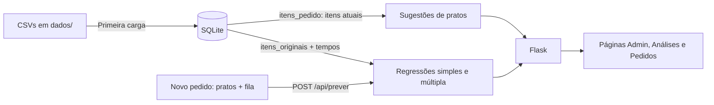

# Comanda: funcionamento, pesos e regressões

Este documento explica como o Comanda funciona: como ele estima o tempo de preparo de um pedido, os pesos das sugestões de pratos, as duas regressões e como comparar os dois modelos. Detalhes de banco, API e frontend estão em [docs/implementacao.md](docs/implementacao.md).

> Os números deste documento foram calculados sobre o banco atual (100 pedidos sintéticos). Se os dados mudarem, os coeficientes também mudam. Os valores atualizados aparecem em `/analises` e em `GET /api/analises`.

## 1. Visão geral

O restaurante quer saber, assim que um pedido chega, quanto tempo ele deve levar para ficar pronto. Com essa estimativa, o atendimento pode informar um prazo realista ao cliente e a cozinha pode se organizar.

O Comanda é uma aplicação Flask + SQLite + NumPy com dois objetivos:

1. **Prever o tempo de preparo** de um pedido com duas regressões lineares ([regressao.py](regressao.py)).
2. **Sugerir pratos** que combinam com o pedido, com base nas categorias escolhidas e no que pedidos parecidos incluíram ([recomendacao.py](recomendacao.py)).



### Fluxo de uma estimativa

1. Na página **Novo pedido**, o atendente marca os pratos e informa quantos pedidos já estão na fila da cozinha.
2. O navegador envia `{"pratos": [...], "pedidos_na_fila": n}` para `POST /api/prever`.
3. O servidor confere se os pratos existem e calcula as três variáveis: **quantidade de itens**, **fila** e **quantidade de categorias distintas**.
4. As duas regressões aplicam seus coeficientes a essas variáveis.
5. A página mostra o tempo estimado pela regressão múltipla em destaque e, abaixo, a conta feita por cada modelo, por exemplo `6,33 + 2,05 × 3 + 1,26 × 6 + 1,15 × 2 = 22,3 min`.

Se o pedido sair da faixa observada nos dados (por exemplo, fila de 30 quando o máximo registrado é 12), a página avisa que a estimativa é uma extrapolação.

### Dados

| Tabela | Conteúdo | Muda pela interface? |
| --- | --- | --- |
| `pedidos` | Cliente, pedidos na fila e tempo real de preparo (min) | Não |
| `categorias`, `pratos` | Cardápio: 10 categorias, 60 pratos | Não |
| `itens_originais` | Pratos de cada pedido no registro; treina as regressões | Não: fotografia fixa |
| `itens_pedido` | Pratos atuais de cada pedido; alimentam as sugestões e os totais | Sim: adicionar ou remover pratos |

Editar os itens de um pedido muda as sugestões e a estimativa para a composição atual, mas **não retreina** as regressões: o tempo real registrado corresponde aos itens originais.

Os 100 pedidos são sintéticos. O tempo real foi simulado como `6 + 2,2 × itens + 1,3 × fila + 0,8 × categorias`, mais um ajuste por tipo de prato (grelhados e risotos mais lentos; bebidas e sobremesas mais rápidas) e um ruído aleatório. Os modelos não conhecem essa fórmula.

## 2. Pesos das sugestões de pratos

As sugestões são recalculadas a cada consulta. Não há modelo treinado: os pesos são valores fixos no código.

### 2.1 Perfil do pedido (peso de cada categoria)

```text
P[p,c] = pratos da categoria c no pedido p / total de pratos do pedido p
```

Exemplo: 2 massas e 2 bebidas geram os pesos 0,5 (Massas) e 0,5 (Bebidas).

### 2.2 Similaridade entre categorias

Cada categoria é representada pelo vetor de quantos pratos dela cada pedido contém. Duas categorias são próximas quando costumam aparecer juntas, nas mesmas proporções:

```text
similaridade(a, b) = cos(a, b) = (a · b) / (|a| × |b|)      entre 0 e 1
```

### 2.3 Componente A: afinidade por categoria

```text
A(p, prato) = Σ_c  P[p,c] × similaridade(c, categoria(prato))
```

Categorias com mais pratos no pedido pesam mais. Um prato de uma categoria ausente do pedido ainda pode pontuar, se ela costuma acompanhar as categorias pedidas.

### 2.4 Componente B: pedidos semelhantes

São escolhidos até **5 pedidos vizinhos**, os de perfil mais parecido (cosseno entre os perfis `P`, desde que positivo). Cada vizinho vota no prato com peso igual à sua similaridade:

```text
B(p, prato) = Σ_v sim(p,v) × contém(v, prato)  /  Σ_v sim(p,v)
```

### 2.5 Pontuação final

| Situação do pedido | Fórmula | Pesos |
| --- | --- | --- |
| Tem itens e vizinhos | `0,5 × A + 0,5 × B` | 50% categoria, 50% pedidos semelhantes |
| Tem itens, sem vizinhos | `A` | 100% categoria |
| Sem itens | `pedidos com o prato / total de pedidos` | 100% popularidade |

Pratos já incluídos são excluídos, e o ranking devolve os 10 primeiros. A pontuação serve para ordenar; **não** é uma probabilidade de o cliente aceitar a sugestão.

### 2.6 Agrupamento de categorias

A página de análises agrupa as categorias em **3 grupos** por agrupamento hierárquico de ligação média, com distância `1 − similaridade`. O resultado é informativo e não altera as sugestões.

## 3. Regressão linear simples

### 3.1 Modelo

```text
Y = B0 + B1·X + E
```

| Símbolo | Significado no projeto |
| --- | --- |
| Y | Variável dependente: tempo de preparo do pedido, em minutos |
| X | Variável independente: quantidade de itens (pratos) no pedido |
| B0 | Intercepto: tempo previsto para um pedido sem itens, que funciona como um tempo fixo de preparo |
| B1 | Coeficiente angular: minutos a mais por item adicionado |
| E | Erro (resíduo): diferença entre o tempo real e o previsto |

### 3.2 Cálculo manual

A função `ajustar_simples` ([regressao.py](regressao.py)) calcula os coeficientes pelas fórmulas de mínimos quadrados, em Python puro, sem função pronta de regressão:

```text
x̄ = Σxi / n                 ȳ = Σyi / n
B1 = Σ(xi − x̄)(yi − ȳ) / Σ(xi − x̄)²
B0 = ȳ − B1·x̄
ŷi = B0 + B1·xi
Ei = yi − ŷi
R² = 1 − ΣEi² / Σ(yi − ȳ)²
```

A soma dos erros é sempre zero. O ajuste exige pelo menos 2 pedidos e variação na quantidade de itens; se todos tivessem o mesmo número de itens, o denominador de B1 seria zero.

O resultado é conferido contra `numpy.polyfit(x, y, 1)`: os coeficientes coincidem até a 15ª casa decimal. A comparação completa está em [COMPARACAO_MANUAL_NUMPY.md](COMPARACAO_MANUAL_NUMPY.md) e aparece na página Análises.

### 3.3 Resultado atual

```text
ŷ = 14,92 + 2,45 × itens
```

- **B1 = 2,45:** cada prato a mais acrescenta, em média, cerca de 2 min 30 s ao preparo.
- **B0 = 14,92:** mesmo um pedido pequeno leva cerca de 15 min. Esse valor absorve tudo o que a simples não enxerga, principalmente a fila da cozinha.
- **R² = 0,447:** a quantidade de itens explica só 45% da variação do tempo.

Exemplo: o pedido #1 (Ana Almeida) tem 1 item, fila de 9 e levou 23,4 min.

```text
ŷ = 14,92 + 2,45 × 1 = 17,4 min
E = 23,4 − 17,4 = 6,0 min   → demorou 6 minutos a mais que o previsto
```

A simples não sabe que havia 9 pedidos na frente, por isso subestimou o tempo.

## 4. Regressão linear múltipla

### 4.1 Modelo

```text
Y = β0 + β1·itens + β2·fila + β3·categorias + E
```

| Variável | Origem |
| --- | --- |
| Y | Tempo de preparo em minutos (mesmo alvo da simples) |
| itens | Quantidade de pratos no pedido (mesmo X da simples) |
| fila | Pedidos já na fila da cozinha quando o pedido chegou |
| categorias | Categorias distintas no pedido (por exemplo, massa + bebida = 2) |

### 4.2 Cálculo

A função `ajustar_modelo` monta a matriz `[1, itens, fila, categorias]` e resolve os mínimos quadrados com `numpy.linalg.lstsq`, usando o mesmo critério da simples (minimizar ΣE²), agora em quatro dimensões. O ajuste exige pelo menos 4 pedidos e variáveis linearmente independentes.

### 4.3 Resultado atual

```text
ŷ = 6,33 + 2,05 × itens + 1,26 × fila + 1,15 × categorias
```

Como ler os pesos (β):

- **β1 = 2,05:** cada item acrescenta cerca de 2 min, com fila e categorias fixas. É menor que o B1 da simples porque parte do efeito que a simples atribuía aos itens pertence às categorias.
- **β2 = 1,26:** cada pedido na fila acrescenta cerca de 1 min 15 s. É a variável que mais melhora a previsão.
- **β3 = 1,15:** cada categoria diferente acrescenta cerca de 1 min, o custo de coordenar estações diferentes da cozinha (chapa, forno, bar).
- **β0 = 6,33:** tempo fixo de um pedido, agora sem o efeito da fila embutido.

Os coeficientes ficaram próximos dos valores usados para gerar os dados (2,2, 1,3 e 0,8). A diferença vem do ruído e dos ajustes por tipo de prato, que o modelo não conhece.

Exemplo, o mesmo pedido #1: `6,33 + 2,05 × 1 + 1,26 × 9 + 1,15 × 1 = 20,9 min`. O resíduo cai de 6,0 para 2,5 min.

A previsão é limitada a zero na exibição. Fora da faixa observada (1 a 8 itens, fila de 0 a 12, 1 a 5 categorias), a página avisa que é uma extrapolação.

## 5. Como comparar as duas regressões

Os dois modelos usam **os mesmos 100 pedidos e o mesmo Y**, então as métricas são diretamente comparáveis.

### 5.1 Métricas

| Métrica | O que mede | Simples | Múltipla | Melhor |
| --- | --- | --- | --- | --- |
| R² | Fração da variação do tempo explicada | 0,447 | 0,830 | Múltipla |
| R² ajustado* | R² penalizado pelo número de variáveis | 0,441 | 0,825 | Múltipla |
| Erro absoluto médio (EAM) | Erro típico, em minutos | 5,23 | 2,78 | Múltipla |
| Raiz do erro quadrático médio* | Erro típico, penalizando erros grandes | 6,19 | 3,43 | Múltipla |
| Maior erro absoluto* | Pior previsão individual | 15,3 min | 10,5 min | Múltipla |

\* Não aparecem na interface; foram calculadas a partir dos resíduos de `GET /api/analises`. As fórmulas estão na seção 5.3.

### 5.2 Interpretação

1. **A múltipla é claramente melhor.** O R² sobe de 0,45 para 0,83, e o erro médio cai quase pela metade, de 5,2 para 2,8 min.
2. **A melhora é real, não um efeito de ter mais variáveis.** O R² sempre aumenta ao acrescentar variáveis, mas o R² ajustado, que penaliza cada variável extra, também sobe muito (0,44 → 0,83).
3. **A fila da cozinha é o fator que faltava.** O mesmo pedido pode levar 10 ou 30 minutos dependendo de quantos pedidos estão na frente, e a simples não tem essa informação.
4. **Na prática, para o atendimento:** com a simples, um prazo informado ao cliente erraria, em média, 5 minutos; com a múltipla, menos de 3.

**Conclusão:** para estimar o tempo de preparo, o restaurante deve usar a regressão múltipla. A simples continua útil como explicação didática do método e mostra que os itens sozinhos não bastam.

### 5.3 Fórmulas usadas na comparação

```text
n = 100 pedidos, p = número de variáveis (1 na simples, 3 na múltipla)

EAM         = Σ|Ei| / n
RMSE        = √(ΣEi² / n)
R²          = 1 − ΣEi² / Σ(yi − ȳ)²
R² ajustado = 1 − (1 − R²) × (n − 1) / (n − p − 1)
```

Todas as métricas são calculadas **na mesma amostra usada no treinamento**. Elas descrevem o ajuste, não o desempenho com pedidos novos. Para isso seria preciso separar dados de teste ou fazer validação cruzada, o que este projeto não faz.

### 5.4 Onde comparar

**Na interface:**
- `/analises`: reta da simples, tabela manual × `numpy.polyfit`, gráficos real × previsto dos dois modelos na mesma escala (quanto mais perto da diagonal, melhor), R² e EAM lado a lado, e a tabela com as duas previsões e os dois resíduos de cada pedido.
- `/pedidos/<id>`: previsão e resíduo do pedido nos dois modelos.
- `/novo-pedido`: a estimativa dos dois modelos para um pedido novo, com a conta de cada um.

**Pela API:**

```powershell
curl http://127.0.0.1:5000/api/analises
```

**Em Python, para calcular as métricas extras:**

```python
import numpy as np
from regressao import obter_analises

a = obter_analises()
obs, n = a['observacoes'], len(a['observacoes'])
for nome, p in [('simples', 1), ('multipla', 3)]:
    e = np.array([o[f'residuo_{nome}'] for o in obs])
    r2 = a[nome]['r_quadrado']
    print(nome, 'R²', round(r2, 4),
          'R² aj.', round(1 - (1 - r2) * (n - 1) / (n - p - 1), 4),
          'EAM', round(np.abs(e).mean(), 3),
          'RMSE', round(np.sqrt((e ** 2).mean()), 3))
```

### 5.5 Checklist para comparar dois modelos de regressão

1. Confirme que os dois usam o mesmo Y e as mesmas observações.
2. Compare o R² ajustado, não apenas o R².
3. Compare os erros em unidades reais (EAM e raiz do erro quadrático médio, em minutos).
4. Veja se os coeficientes novos têm tamanho relevante na prática.
5. Observe os gráficos real × previsto: os pontos devem ficar perto da diagonal, sem padrão.
6. Com desempenho parecido, prefira o modelo mais simples. Aqui o desempenho não é parecido, então a múltipla vence.
