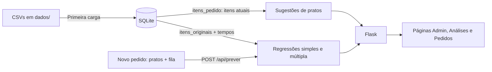

# Comanda: funcionamento, pesos e regressões

Este documento explica como o Comanda funciona: como ele estima o tempo de preparo de um pedido, os pesos das sugestões de pratos, as duas regressões e como comparar os dois modelos. Detalhes de banco, API e frontend estão em [docs/implementacao.md](docs/implementacao.md).

> Os números deste documento foram calculados sobre o banco atual (100 pedidos sintéticos). Se os dados mudarem, os coeficientes também mudam. Os valores atualizados aparecem em `/analises` e em `GET /api/analises`.

## 1. Visão geral

O restaurante quer saber, assim que um pedido chega, quanto tempo ele deve levar para ficar pronto. Com essa estimativa, o atendimento pode informar um prazo realista ao cliente e a cozinha pode se organizar.

O Comanda é uma aplicação Flask + SQLite + NumPy com dois objetivos:

1. **Prever o tempo de preparo** de um pedido com duas regressões lineares ([regressao.py](regressao.py)).
2. **Sugerir pratos** que combinam com o pedido, com base nas categorias escolhidas e no que pedidos parecidos incluíram ([recomendacao.py](recomendacao.py)).



### Fluxo de uma estimativa

1. Na página **Novo pedido**, o atendente marca os pratos e informa quantos pedidos já estão na fila da cozinha.
2. O navegador envia `{"pratos": [...], "pedidos_na_fila": n}` para `POST /api/prever`.
3. O servidor confere se os pratos existem, busca o **tempo individual de preparo** de cada um e calcula as variáveis: **tempo dos pratos** (soma desses tempos), **fila** e **quantidade de categorias distintas**.
4. As duas regressões aplicam seus coeficientes a essas variáveis.
5. A página mostra o tempo estimado pela regressão múltipla em destaque e, abaixo, a conta feita por cada modelo. Para Espaguete à bolonhesa (12 min), Lasanha à bolonhesa (18 min) e Picanha grelhada (20 min) com 6 pedidos na fila, por exemplo, aparece `9,02 + 0,45 × 50,0 + 1,32 × 6 + 0,24 × 2 = 39,7 min`. A previsão da simples também é conferida com `numpy.polyfit`, e a diferença aparece na tela.

Se o pedido sair da faixa observada nos dados (por exemplo, fila de 30 quando o máximo registrado é 12, ou mais de 145 min de pratos), a página avisa que a estimativa é uma extrapolação.

### Dados

| Tabela | Conteúdo | Muda pela interface? |
| --- | --- | --- |
| `pedidos` | Cliente, pedidos na fila e tempo real de preparo (min) | Não |
| `categorias`, `pratos` | Cardápio: 10 categorias, 60 pratos, cada um com seu tempo de preparo (`tempo_prato_min`) | Não |
| `itens_originais` | Pratos de cada pedido no registro; treina as regressões | Não: fotografia fixa |
| `itens_pedido` | Pratos atuais de cada pedido; alimentam as sugestões e os totais | Sim: adicionar ou remover pratos |

Editar os itens de um pedido muda as sugestões e a estimativa para a composição atual, mas **não retreina** as regressões: o tempo real registrado corresponde aos itens originais.

### Tempo de cada prato

Cada prato tem um tempo individual de preparo, definido pela complexidade:

| Categoria | Faixa (min) | Exemplos |
| --- | --- | --- |
| Bebidas | 1–4 | Refrigerante 1, Café expresso 2, Limonada suíça 4 |
| Sobremesas | 2–7 | Pudim 2, Brownie com sorvete 5, Petit gâteau 7 |
| Saladas | 4–7 | Salada verde 4, Caesar 6, Quinoa 7 |
| Sopas | 6–9 | Sopa de legumes 6, Caldo verde 8, Canja 9 |
| Entradas | 6–11 | Carpaccio 6, Bolinho de bacalhau 10, Croquete de costela 11 |
| Lanches | 6–11 | Misto quente 6, X-burger 10, Hambúrguer vegetariano 11 |
| Porções | 9–15 | Calabresa acebolada 9, Batata frita 10, Frango a passarinho 15 |
| Massas | 11–18 | Penne ao pesto 11, Espaguete 12, Lasanha 18 |
| Grelhados | 14–22 | Linguiça 14, Picanha 20, Costela suína 22 |
| Risotos | 19–22 | Limão-siciliano 19, Cogumelos 20, Camarão 22 |

A lista completa está em `dados/pratos.csv`, no `/cardapio` e ao lado de cada prato no Novo pedido.

### Como o tempo real foi gerado

Os 100 pedidos são sintéticos ([preparar_dados.py](preparar_dados.py)). Uma cozinha prepara os pratos **em paralelo**: o prato mais demorado define a base, e cada prato a mais acrescenta só uma parte do próprio tempo.

```text
cozinha    = maior tempo + 0,35 × (soma dos tempos − maior tempo)
tempo real = 3 + cozinha + 1,3 × fila + 0,8 × categorias + ruído (desvio-padrão de 2,2 min)
```

Os modelos não conhecem essa regra. A regressão usa a **soma** dos tempos, que é só uma aproximação do paralelismo; essa é a parte que ela não consegue explicar.

## 2. Pesos das sugestões de pratos

As sugestões são recalculadas a cada consulta. Não há modelo treinado: os pesos são valores fixos no código.

### 2.1 Perfil do pedido (peso de cada categoria)

```text
P[p,c] = pratos da categoria c no pedido p / total de pratos do pedido p
```

Exemplo: 2 massas e 2 bebidas geram os pesos 0,5 (Massas) e 0,5 (Bebidas).

### 2.2 Similaridade entre categorias

Cada categoria é representada pelo vetor de quantos pratos dela cada pedido contém. Duas categorias são próximas quando costumam aparecer juntas, nas mesmas proporções:

```text
similaridade(a, b) = cos(a, b) = (a · b) / (|a| × |b|)      entre 0 e 1
```

### 2.3 Componente A: afinidade por categoria

```text
A(p, prato) = Σ_c  P[p,c] × similaridade(c, categoria(prato))
```

Categorias com mais pratos no pedido pesam mais. Um prato de uma categoria ausente do pedido ainda pode pontuar, se ela costuma acompanhar as categorias pedidas.

### 2.4 Componente B: pedidos semelhantes

São escolhidos até **5 pedidos vizinhos**, os de perfil mais parecido (cosseno entre os perfis `P`, desde que positivo). Cada vizinho vota no prato com peso igual à sua similaridade:

```text
B(p, prato) = Σ_v sim(p,v) × contém(v, prato)  /  Σ_v sim(p,v)
```

### 2.5 Pontuação final

| Situação do pedido | Fórmula | Pesos |
| --- | --- | --- |
| Tem itens e vizinhos | `0,5 × A + 0,5 × B` | 50% categoria, 50% pedidos semelhantes |
| Tem itens, sem vizinhos | `A` | 100% categoria |
| Sem itens | `pedidos com o prato / total de pedidos` | 100% popularidade |

Pratos já incluídos são excluídos, e o ranking devolve os 10 primeiros. A pontuação serve para ordenar; **não** é uma probabilidade de o cliente aceitar a sugestão.

### 2.6 Agrupamento de categorias

A página de análises agrupa as categorias em **3 grupos** por agrupamento hierárquico de ligação média, com distância `1 − similaridade`. O resultado é informativo e não altera as sugestões.

## 3. Regressão linear simples

### 3.1 Modelo

```text
Y = B0 + B1·X + E
```

| Símbolo | Significado no projeto |
| --- | --- |
| Y | Variável dependente: tempo de preparo do pedido, em minutos |
| X | Variável independente: **tempo dos pratos**, a soma dos tempos individuais dos pratos do pedido (`tempo_base_itens`), em minutos |
| B0 | Intercepto: tempo fixo de um pedido (recepção, montagem, entrega e, na simples, a fila média) |
| B1 | Coeficiente angular: minutos a mais no pedido para cada minuto de prato acrescentado |
| E | Erro (resíduo): diferença entre o tempo real e o previsto |

### 3.2 Cálculo manual

A função `ajustar_simples` ([regressao.py](regressao.py)) calcula os coeficientes pelas fórmulas de mínimos quadrados, em Python puro, sem função pronta de regressão:

```text
x̄ = Σxi / n                 ȳ = Σyi / n
B1 = Σ(xi − x̄)(yi − ȳ) / Σ(xi − x̄)²
B0 = ȳ − B1·x̄
ŷi = B0 + B1·xi
Ei = yi − ŷi
R² = 1 − ΣEi² / Σ(yi − ȳ)²
```

A soma dos erros é sempre zero. O ajuste exige pelo menos 2 pedidos e variação no tempo dos pratos; se todos os pedidos tivessem o mesmo tempo de pratos, o denominador de B1 seria zero.

A função usa só Python puro (listas, `sum`, laços), sem NumPy. O resultado é conferido contra `numpy.polyfit(x, y, 1)`: os coeficientes coincidem até a 15ª casa decimal, e o R² é idêntico. A comparação completa está em [COMPARACAO_MANUAL_NUMPY.md](COMPARACAO_MANUAL_NUMPY.md) e aparece na página Análises.

**Por que o tempo dos pratos, e não a quantidade de itens?** Contar itens trata 1 água com gás (1 min) igual a 1 risoto de camarão (22 min). Somar os tempos individuais dá a cada prato o peso que ele tem na cozinha. Com os mesmos dados, a simples com X = itens explica só 35% da variação (R² = 0,345); com X = tempo dos pratos, explica 84%.

### 3.3 Resultado atual

```text
ŷ = 17,66 + 0,437 × tempo dos pratos
```

- **B1 = 0,437:** cada minuto de prato acrescenta, em média, só 26 segundos ao pedido. B1 bem menor que 1 é a **marca do paralelismo**: a cozinha prepara vários pratos ao mesmo tempo, então o pedido não leva a soma dos tempos.
- **B0 = 17,66:** tempo fixo de um pedido. Ele absorve o que a simples não enxerga, principalmente a fila média da cozinha (6 pedidos).
- **R² = 0,843:** o tempo dos pratos explica 84% da variação do tempo de preparo.

Exemplo: o pedido #1 (Ana Almeida) tem 1 prato, Creme de cebola (7 min), com fila de 9, e levou 25,2 min.

```text
ŷ = 17,66 + 0,437 × 7 = 20,7 min
E = 25,2 − 20,7 = 4,5 min   → demorou 4,5 minutos a mais que o previsto
```

A simples não sabe que havia 9 pedidos na frente, por isso subestimou o tempo.

## 4. Regressão linear múltipla

### 4.1 Modelo

```text
Y = β0 + β1·tempo dos pratos + β2·fila + β3·categorias + E
```

| Variável | Origem |
| --- | --- |
| Y | Tempo de preparo em minutos (mesmo alvo da simples) |
| tempo dos pratos | Soma dos tempos individuais dos pratos (mesmo X da simples) |
| fila | Pedidos já na fila da cozinha quando o pedido chegou |
| categorias | Categorias distintas no pedido (por exemplo, massa + bebida = 2) |

A quantidade de itens saiu do modelo: ela anda junto com o tempo dos pratos (correlação de 0,66), e mantê-la deixaria seu coeficiente negativo e sem interpretação.

### 4.2 Cálculo

A função `ajustar_modelo` monta a matriz `[1, tempo dos pratos, fila, categorias]` e resolve os mínimos quadrados com `numpy.linalg.lstsq`, usando o mesmo critério da simples (minimizar ΣE²), agora em quatro dimensões. O ajuste exige pelo menos 4 pedidos e variáveis linearmente independentes.

### 4.3 Resultado atual

```text
ŷ = 9,02 + 0,447 × tempo dos pratos + 1,32 × fila + 0,24 × categorias
```

Como ler os pesos (β). Cada um vale com as outras variáveis fixas:

- **β1 = 0,447:** cada minuto de prato acrescenta cerca de 27 segundos ao pedido, quase o mesmo que na simples. O tempo dos pratos não dependia da fila, então separar os efeitos quase não mudou esse coeficiente.
- **β2 = 1,32:** cada pedido na fila acrescenta cerca de 1 min 20 s. É a variável que a simples não tinha.
- **β3 = 0,24:** cada categoria diferente acrescenta cerca de 15 segundos, um efeito pequeno.
- **β0 = 9,02:** tempo fixo de um pedido, agora sem o efeito da fila embutido.

O β2 ficou próximo do valor usado para gerar os dados (1,3). O β1 de 0,447 resume a regra de paralelismo (maior prato + 35% do resto) numa única reta.

Exemplo, o mesmo pedido #1: `9,02 + 0,447 × 7 + 1,32 × 9 + 0,24 × 1 = 24,2 min`. O resíduo cai de 4,5 para 1,0 min.

A previsão é limitada a zero na exibição. Fora da faixa observada (2 a 145 min de pratos, fila de 0 a 12, 1 a 5 categorias), a página avisa que é uma extrapolação.

### 4.4 Limite do modelo linear: o paralelismo

A soma dos tempos é só uma aproximação de como a cozinha trabalha. Veja o pedido #12: 8 pratos que somam 72 min, mas o maior deles leva só 13 min (Fettuccine Alfredo).

```text
Real:      37,0 min   (pratos rápidos feitos em paralelo)
Simples:   49,1 min   → erro de −12,1 min
Múltipla:  43,7 min   → erro de −6,7 min
```

Muitos pratos rápidos somam bastante, mas ficam prontos quase juntos, então o modelo superestima esse tipo de pedido. Para capturar isso, seria preciso uma variável como "maior tempo entre os pratos". Essa é uma melhoria possível, mas sai da regressão simples pedida.

## 5. Como comparar as duas regressões

Os dois modelos usam **os mesmos 100 pedidos e o mesmo Y**, então as métricas são diretamente comparáveis.

### 5.1 Métricas

| Métrica | O que mede | Simples | Múltipla | Melhor |
| --- | --- | --- | --- | --- |
| R² | Fração da variação do tempo explicada | 0,843 | 0,960 | Múltipla |
| R² ajustado* | R² penalizado pelo número de variáveis | 0,841 | 0,959 | Múltipla |
| Erro absoluto médio (EAM) | Erro típico, em minutos | 5,12 | 2,46 | Múltipla |
| Raiz do erro quadrático médio* | Erro típico, penalizando erros grandes | 6,12 | 3,07 | Múltipla |
| Maior erro absoluto* | Pior previsão individual | 13,7 min | 7,0 min | Múltipla |

\* Não aparecem na interface; foram calculadas a partir dos resíduos de `GET /api/analises`. As fórmulas estão na seção 5.3.

**Antes e depois do tempo dos pratos**, com os mesmos 100 pedidos:

| Modelo | Variáveis | R² |
| --- | --- | --- |
| Simples (versão anterior) | itens | 0,345 |
| Simples (atual) | tempo dos pratos | **0,843** |
| Múltipla (versão anterior) | itens, fila, categorias | 0,429 |
| Múltipla (atual) | tempo dos pratos, fila, categorias | **0,960** |

Com o tempo real gerado a partir do tempo de cada prato, contar itens deixou de bastar: a nova simples, com uma única variável, já supera a múltipla antiga com três.

### 5.2 Interpretação

1. **O tempo dos pratos é a variável principal.** Sozinho, ele explica 84% da variação, contra 35% da quantidade de itens.
2. **A múltipla é claramente melhor.** O R² sobe de 0,84 para 0,96, e o erro médio cai pela metade, de 5,1 para 2,5 min.
3. **A melhora é real, não um efeito de ter mais variáveis.** O R² sempre aumenta ao acrescentar variáveis, mas o R² ajustado, que penaliza cada variável extra, também sobe (0,841 → 0,959).
4. **A fila da cozinha é o fator que faltava à simples.** O mesmo pedido pode levar 10 minutos a mais ou a menos dependendo de quantos pedidos estão na frente.
5. **Na prática, para o atendimento:** com a simples, um prazo informado ao cliente erraria, em média, 5 minutos; com a múltipla, cerca de 2,5.

**Conclusão:** para estimar o tempo de preparo, o restaurante deve usar a regressão múltipla. A simples continua útil como explicação didática do método e mostra que o tempo dos pratos, e não a quantidade, é o que mais pesa. Lembre que os tempos foram gerados por uma regra sintética (seção 1); com dados reais, os coeficientes precisariam ser medidos de novo.

### 5.3 Fórmulas usadas na comparação

```text
n = 100 pedidos, p = número de variáveis (1 na simples, 3 na múltipla)

EAM         = Σ|Ei| / n
RMSE        = √(ΣEi² / n)
R²          = 1 − ΣEi² / Σ(yi − ȳ)²
R² ajustado = 1 − (1 − R²) × (n − 1) / (n − p − 1)
```

Todas as métricas são calculadas **na mesma amostra usada no treinamento**. Elas descrevem o ajuste, não o desempenho com pedidos novos. Para isso seria preciso separar dados de teste ou fazer validação cruzada, o que este projeto não faz.

### 5.4 Onde comparar

**Na interface:**
- `/analises`: reta da simples, tabela manual × `numpy.polyfit`, gráficos real × previsto dos dois modelos na mesma escala (quanto mais perto da diagonal, melhor), R² e EAM lado a lado, e a tabela com as duas previsões e os dois resíduos de cada pedido.
- `/pedidos/<id>`: previsão e resíduo do pedido nos dois modelos.
- `/novo-pedido`: a estimativa dos dois modelos para um pedido novo, com a conta de cada um.

**Pela API:**

```powershell
curl http://127.0.0.1:5000/api/analises
```

**Em Python, para calcular as métricas extras:**

```python
import numpy as np
from regressao import obter_analises

a = obter_analises()
obs, n = a['observacoes'], len(a['observacoes'])
for nome, p in [('simples', 1), ('multipla', 3)]:
    e = np.array([o[f'residuo_{nome}'] for o in obs])
    r2 = a[nome]['r_quadrado']
    print(nome, 'R²', round(r2, 4),
          'R² aj.', round(1 - (1 - r2) * (n - 1) / (n - p - 1), 4),
          'EAM', round(np.abs(e).mean(), 3),
          'RMSE', round(np.sqrt((e ** 2).mean()), 3))
```

### 5.5 Checklist para comparar dois modelos de regressão

1. Confirme que os dois usam o mesmo Y e as mesmas observações.
2. Compare o R² ajustado, não apenas o R².
3. Compare os erros em unidades reais (EAM e raiz do erro quadrático médio, em minutos).
4. Veja se os coeficientes novos têm tamanho relevante na prática.
5. Observe os gráficos real × previsto: os pontos devem ficar perto da diagonal, sem padrão.
6. Com desempenho parecido, prefira o modelo mais simples. Aqui o desempenho não é parecido, então a múltipla vence.
