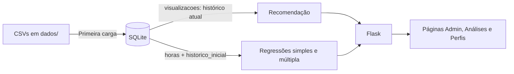

# StreamData: funcionamento, pesos e regressões

Este documento explica como o StreamData funciona: os pesos do recomendador, as duas regressões e como comparar os dois modelos. Detalhes de banco, API e frontend estão em [docs/implementacao.md](docs/implementacao.md).

> Os números deste documento foram calculados sobre o banco atual (100 usuários, histórico inicial). Se o histórico inicial ou os gêneros do catálogo mudarem, os coeficientes também mudam. Os valores atualizados aparecem em `/analises` e em `GET /api/analises`.

## 1. Visão geral do funcionamento

O StreamData é uma aplicação Flask + SQLite + NumPy com dois objetivos independentes:

1. **Recomendar títulos** que o usuário ainda não viu, com base nos gêneros que ele consome e no que usuários parecidos assistiram ([recomendacao.py](recomendacao.py)).
2. **Explicar e prever o engajamento** (horas assistidas por dia) com duas regressões lineares ([regressao.py](regressao.py)).



Os dados ficam em duas tabelas de histórico:

| Tabela | Usada por | Muda pela interface? |
| --- | --- | --- |
| `visualizacoes` | Recomendação e totais de consumo | Sim: marcar ou desmarcar um título como visto |
| `historico_inicial` | Regressões | Não: é uma fotografia fixa da primeira carga |

Assim, marcar um título muda as recomendações na hora, mas **não retreina** as regressões.

Para executar:

```powershell
.\.venv\Scripts\python.exe app.py              # abre em http://127.0.0.1:5000
.\.venv\Scripts\python.exe -m unittest discover -s tests
```

## 2. Pesos da recomendação

Toda a recomendação é recalculada a cada consulta. Não há modelo treinado nem pesos aprendidos: os pesos são valores fixos definidos no código.

### 2.1 Perfil do usuário (peso de cada gênero)

Para cada usuário, o peso de um gênero é a fração do histórico dele naquele gênero:

```text
P[u,g] = títulos do gênero g vistos por u / total de títulos vistos por u
```

Exemplo: 3 títulos de Ação e 1 de Aventura geram os pesos 0,75 (Ação) e 0,25 (Aventura). A soma dos pesos de cada usuário é 1.

### 2.2 Similaridade entre gêneros

Cada gênero é representado pelo vetor de quantos títulos dele cada usuário viu. Dois gêneros são próximos quando são consumidos pelas mesmas pessoas, nas mesmas proporções:

```text
similaridade(a, b) = cos(a, b) = (a · b) / (|a| × |b|)      entre 0 e 1
```

### 2.3 Componente A: afinidade por gênero

```text
A(u, c) = Σ_g  P[u,g] × similaridade(g, gênero(c))
```

O perfil do usuário funciona como peso: gêneros que ele assiste mais contam mais. Um título de um gênero que o usuário nunca viu ainda pode pontuar, se esse gênero for parecido com os que ele vê.

### 2.4 Componente B: filtragem colaborativa

São escolhidos até **5 vizinhos**: os usuários com maior similaridade de cosseno entre os perfis `P`, desde que ela seja positiva. Cada vizinho vota no título com peso igual à sua similaridade:

```text
B(u, c) = Σ_v sim(u,v) × viu(v,c)  /  Σ_v sim(u,v)
```

`viu(v,c)` vale 1 se o vizinho viu o título e 0 caso contrário. Por isso, B é a fração ponderada dos vizinhos que viram o título.

### 2.5 Pontuação final

| Situação do usuário | Fórmula | Pesos |
| --- | --- | --- |
| Tem histórico e vizinhos | `0,5 × A + 0,5 × B` | 50% gênero, 50% colaborativo |
| Tem histórico, sem vizinhos | `A` | 100% gênero |
| Sem histórico | `vistos do título / total de usuários` | 100% popularidade |

Títulos já vistos são excluídos. O ranking ordena por pontuação, depois por popularidade e depois por ID, e devolve os 10 primeiros. Exemplo: A = 0,8 e B = 0,6 resultam em pontuação 0,7. Esse valor serve para ordenar os títulos; ele **não** é uma probabilidade de o usuário gostar.

### 2.6 Agrupamento de gêneros (clusters)

A página de análises também agrupa os gêneros em **3 clusters** por agrupamento hierárquico de ligação média, com distância `1 − similaridade`. O resultado é apenas informativo: não altera os pesos do ranking.

## 3. Regressão linear simples

### 3.1 Modelo

```text
Y = B0 + B1·X + E
```

| Símbolo | Significado no projeto |
| --- | --- |
| Y | Variável dependente: horas assistidas por dia (`tempo_assistindo_horas`) |
| X | Variável independente: horas na plataforma por dia (`tempo_plataforma_horas`) |
| B0 | Intercepto: valor previsto de Y quando X = 0 |
| B1 | Coeficiente angular: quanto Y muda a cada hora a mais de X |
| E | Erro (resíduo): diferença entre o Y observado e o previsto |

### 3.2 Cálculo manual (mínimos quadrados)

A função `ajustar_simples` ([regressao.py](regressao.py)) calcula os coeficientes diretamente pelas fórmulas, sem usar uma função pronta de regressão:

```text
x̄ = Σxi / n                 ȳ = Σyi / n
B1 = Σ(xi − x̄)(yi − ȳ) / Σ(xi − x̄)²
B0 = ȳ − B1·x̄
ŷi = B0 + B1·xi
Ei = yi − ŷi
R² = 1 − ΣEi² / Σ(yi − ȳ)²
```

Essas fórmulas escolhem a reta que minimiza a soma dos erros ao quadrado. Uma consequência é que a soma dos erros é sempre zero. O ajuste exige pelo menos 2 observações e variação em X; se todos os X forem iguais, o denominador de B1 é zero.

### 3.3 Resultado atual

```text
ŷ = 0,0011 + 0,6535 × horas_na_plataforma
```

- **B1 = 0,6535:** cada hora a mais na plataforma corresponde, em média, a cerca de 39 minutos a mais assistindo.
- **B0 ≈ 0:** sem tempo na plataforma, praticamente não há tempo assistido, o que é coerente.
- **R² = 0,8749:** a reta explica cerca de 87% da variação das horas assistidas.

Exemplo: a usuária 1 (Ana Almeida) passa 6 h na plataforma e assiste 2,5 h.

```text
ŷ = 0,0011 + 0,6535 × 6 = 3,92 h
E = 2,5 − 3,92 = −1,42 h   → assistiu menos do que o modelo esperava
```

## 4. Regressão linear múltipla

### 4.1 Modelo

```text
Y = β0 + β1·horas_na_plataforma + β2·quantidade_vistos + β3·quantidade_generos + E
```

| Variável | Origem |
| --- | --- |
| Y | Horas assistidas por dia (mesmo alvo da simples) |
| horas_na_plataforma | Mesmo X da regressão simples |
| quantidade_vistos | Número de títulos no `historico_inicial` do usuário |
| quantidade_generos | Número de gêneros distintos nesse histórico |

### 4.2 Cálculo

A função `ajustar_modelo` monta a matriz `[1, x1, x2, x3]` e resolve os mínimos quadrados com `numpy.linalg.lstsq`. O critério é o mesmo da regressão simples, minimizar ΣE², agora em quatro dimensões. O ajuste exige pelo menos 4 observações e variáveis linearmente independentes (posto 4).

### 4.3 Resultado atual

```text
ŷ = 0,1146 + 0,6541 × horas_na_plataforma
           + 0,0017 × quantidade_vistos
           − 0,0353 × quantidade_generos
```

Como ler os pesos (β):

- **β1 = 0,6541:** quase idêntico ao B1 da simples. As horas na plataforma continuam explicando quase tudo.
- **β2 = 0,0017:** cada título a mais no histórico acrescenta cerca de 6 segundos por dia, um efeito praticamente nulo.
- **β3 = −0,0353:** cada gênero a mais reduz cerca de 2 minutos por dia, também um efeito muito pequeno.

Cada β mede o efeito da sua variável com as outras mantidas constantes. As variáveis têm escalas diferentes (horas, quantidade de títulos e de gêneros), por isso o tamanho do coeficiente não indica sozinho a importância da variável.

A previsão do simulador em `/analises` (`POST /api/prever`) é limitada entre 0 e as horas na plataforma. O sistema avisa quando a entrada sai do intervalo observado (0,5–8 h, 0–17 títulos, 0–6 gêneros), porque nesse caso a previsão é uma extrapolação.

## 5. Como comparar as duas regressões

Os dois modelos usam **os mesmos 100 usuários e o mesmo Y**, então as métricas são diretamente comparáveis.

### 5.1 Métricas

| Métrica | O que mede | Simples | Múltipla | Melhor |
| --- | --- | --- | --- | --- |
| R² | Fração da variação de Y explicada | 0,8749 | 0,8757 | Múltipla (+0,0008) |
| R² ajustado* | R² penalizado pelo número de variáveis | 0,8736 | 0,8718 | Simples |
| Erro absoluto médio (EAM) | Erro típico, em horas | 0,4463 | 0,4481 | Simples |
| Raiz do erro quadrático médio* | Erro típico, penalizando erros grandes | 0,5637 | 0,5619 | Múltipla |
| Maior erro absoluto* | Pior previsão individual | 1,52 h | 1,51 h | Empate prático |

\* Não aparecem na interface; foram calculados a partir dos resíduos de `GET /api/analises`. As fórmulas estão na seção 5.3.

### 5.2 Interpretação

1. **O R² da múltipla sempre fica igual ou maior.** Acrescentar variáveis nunca piora o ajuste na própria amostra, mesmo quando elas não ajudam. Por isso, um R² maior por si só não prova que o modelo é melhor.
2. **O R² ajustado corrige isso** penalizando cada variável extra. Aqui ele diminui na múltipla: as duas variáveis novas não compensam a complexidade que adicionam.
3. **O EAM é praticamente igual**, e a simples fica até um pouco à frente. A múltipla minimiza o erro *ao quadrado*, por isso melhora a raiz do erro quadrático médio, mas não necessariamente o erro absoluto.
4. **Os coeficientes confirmam a conclusão:** β1 ≈ B1, e β2 e β3 são próximos de zero.

**Conclusão com os dados atuais:** as horas na plataforma explicam quase todo o engajamento. A regressão simples tem desempenho equivalente e é mais fácil de interpretar. A quantidade de títulos e de gêneros do histórico inicial quase não acrescenta informação. Isso é esperado, porque o histórico foi gerado sinteticamente sem relação direta com as horas (ver [docs/implementacao.md](docs/implementacao.md), seção 2).

### 5.3 Fórmulas usadas na comparação

```text
n = 100 observações, p = número de variáveis (1 na simples, 3 na múltipla)

EAM        = Σ|Ei| / n
RMSE       = √(ΣEi² / n)
R²         = 1 − ΣEi² / Σ(yi − ȳ)²
R² ajustado = 1 − (1 − R²) × (n − 1) / (n − p − 1)
```

Todas as métricas são calculadas **na mesma amostra usada no treinamento**. Elas descrevem o ajuste, não o desempenho com usuários novos. Para isso seria preciso separar dados de teste ou fazer validação cruzada, o que este projeto não faz.

### 5.4 Onde comparar

**Na interface (`/analises`):**
- O gráfico da regressão simples mostra a dispersão de X × Y com a reta ajustada.
- Os gráficos de *observado × previsto* dos dois modelos usam a mesma escala. Quanto mais perto da diagonal estiverem os pontos, melhor a previsão.
- Os cartões mostram R² e EAM de cada modelo lado a lado.
- A tabela de observações lista, para cada usuário, as duas previsões e os dois resíduos.
- O perfil de cada usuário (`/usuarios/<id>`) mostra a previsão e o resíduo dele nos dois modelos.

**Pela API:**

```powershell
curl http://127.0.0.1:5000/api/analises
```

A resposta traz `simples` e `multipla` (coeficientes, fórmula, `r_quadrado`, `erro_absoluto_medio`) e `observacoes`, com `previsao_simples`, `previsao_multipla`, `residuo_simples` e `residuo_multipla` de cada usuário.

**Em Python, para calcular as métricas extras:**

```python
import numpy as np
from regressao import obter_analises

a = obter_analises()
obs, n = a['observacoes'], len(a['observacoes'])
for nome, p in [('simples', 1), ('multipla', 3)]:
    e = np.array([o[f'residuo_{nome}'] for o in obs])
    r2 = a[nome]['r_quadrado']
    print(nome, 'R²', round(r2, 4),
          'R² aj.', round(1 - (1 - r2) * (n - 1) / (n - p - 1), 4),
          'EAM', round(np.abs(e).mean(), 4),
          'RMSE', round(np.sqrt((e ** 2).mean()), 4))
```

### 5.5 Checklist para comparar dois modelos de regressão

1. Confirme que os dois usam o mesmo Y e as mesmas observações.
2. Compare o R² ajustado, não apenas o R².
3. Compare os erros em unidades reais (EAM e raiz do erro quadrático médio, em horas).
4. Veja se os coeficientes novos têm tamanho relevante na prática.
5. Observe os gráficos de resíduos: os erros devem se espalhar sem padrão em torno de zero.
6. Com desempenho parecido, prefira o modelo mais simples.
