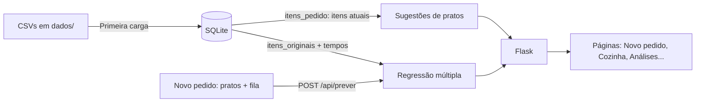

# Comanda: documentação completa

Este documento explica em detalhe como o Comanda funciona: como ele estima o tempo de preparo de um pedido, os pesos das sugestões de pratos, a regressão múltipla e como avaliar o modelo. A versão resumida, para estudar ou apresentar, é o [Guia didático](GUIA_DIDATICO.md). Detalhes de código, banco, API e frontend estão em [docs/implementacao.md](docs/implementacao.md).

> Os números deste documento foram calculados sobre o banco atual (100 pedidos sintéticos). Se os dados mudarem, os coeficientes também mudam. Os valores atualizados aparecem em `/analises` e em `GET /api/analises`.

## 1. Visão geral

O restaurante quer saber, assim que um pedido chega, quanto tempo ele deve levar para ficar pronto. Com essa estimativa, o atendimento pode informar um prazo realista ao cliente e a cozinha pode se organizar.

O Comanda é uma aplicação Flask + SQLite + NumPy com dois objetivos:

1. **Prever o tempo de preparo** de um pedido com uma regressão linear múltipla, calculada à mão em Python puro e conferida com o NumPy ([comanda/modelo/](comanda/modelo/)).
2. **Sugerir pratos** que combinam com o pedido, com base nas categorias escolhidas e no que pedidos parecidos incluíram ([comanda/recomendacao.py](comanda/recomendacao.py)).



### Fluxo de uma estimativa

1. Na página **Novo pedido**, o atendente marca os pratos e informa quantos pedidos já estão na fila da cozinha.
2. O navegador envia `{"pratos": [...], "pedidos_na_fila": n}` para `POST /api/prever`.
3. O servidor confere se os pratos existem, busca o **tempo individual de preparo** de cada um e calcula as variáveis: o **maior prato** (o tempo do prato mais demorado), os **demais pratos** (a soma dos outros), a **fila** e a **quantidade de categorias distintas**.
4. A regressão múltipla aplica seus coeficientes a essas variáveis.
5. A página mostra o tempo estimado em destaque e, abaixo, a conta feita. Para Espaguete à bolonhesa (12 min), Lasanha à bolonhesa (18 min) e Picanha grelhada (20 min) com 6 pedidos na fila, por exemplo, aparece `3,37 + 0,89 × 20,0 + 0,35 × 30,0 + 1,32 × 6 + 1,03 × 2 = 41,8 min`. A mesma previsão é refeita com os coeficientes do `numpy.linalg.lstsq`, e a diferença aparece na tela.

Se o pedido sair da faixa observada nos dados (por exemplo, fila de 30 quando o máximo registrado é 12, ou um prato acima de 22 min), a página avisa que a estimativa é uma extrapolação.

### Dados

| Tabela | Conteúdo | Muda pela interface? |
| --- | --- | --- |
| `pedidos` | Cliente, pedidos na fila e tempo real de preparo (min) | Não |
| `categorias`, `pratos` | Cardápio: 10 categorias, 60 pratos, cada um com seu tempo de preparo (`tempo_prato_min`) | Não |
| `itens_originais` | Pratos de cada pedido no registro; treina a regressão | Não: fotografia fixa |
| `itens_pedido` | Pratos atuais de cada pedido; alimentam as sugestões e os totais | Sim: adicionar ou remover pratos |

Editar os itens de um pedido muda as sugestões e a estimativa para a composição atual, mas **não retreina** a regressão: o tempo real registrado corresponde aos itens originais.

### Tempo de cada prato

Cada prato tem um tempo individual de preparo, definido pela complexidade:

| Categoria | Faixa (min) | Exemplos |
| --- | --- | --- |
| Bebidas | 1–4 | Refrigerante 1, Café expresso 2, Limonada suíça 4 |
| Sobremesas | 2–7 | Pudim 2, Brownie com sorvete 5, Petit gâteau 7 |
| Saladas | 4–7 | Salada verde 4, Caesar 6, Quinoa 7 |
| Sopas | 6–9 | Sopa de legumes 6, Caldo verde 8, Canja 9 |
| Entradas | 6–11 | Carpaccio 6, Bolinho de bacalhau 10, Croquete de costela 11 |
| Lanches | 6–11 | Misto quente 6, X-burger 10, Hambúrguer vegetariano 11 |
| Porções | 9–15 | Calabresa acebolada 9, Batata frita 10, Frango a passarinho 15 |
| Massas | 11–18 | Penne ao pesto 11, Espaguete 12, Lasanha 18 |
| Grelhados | 14–22 | Linguiça 14, Picanha 20, Costela suína 22 |
| Risotos | 19–22 | Limão-siciliano 19, Cogumelos 20, Camarão 22 |

A lista completa está em `dados/pratos.csv`, no `/cardapio` e ao lado de cada prato no Novo pedido.

### Como o tempo real foi gerado

Os 100 pedidos são sintéticos: a regra está em [comanda/cozinha.py](comanda/cozinha.py), e [comanda/dados.py](comanda/dados.py) gera os CSVs com semente fixa. Uma cozinha prepara os pratos **em paralelo**: o prato mais demorado define a base, e cada prato a mais acrescenta só uma parte do próprio tempo.

```text
cozinha    = maior tempo + 0,35 × (soma dos tempos − maior tempo)
tempo real = 3 + cozinha + 1,3 × fila + 0,8 × categorias + ruído (desvio-padrão de 3,7 min)
```

O **ruído** representa o que nenhuma variável registra numa cozinha real: equipe do turno, forno atrasado, horário de pico. Seu tamanho (desvio de 3,7 min) foi **calibrado** para que o modelo correto reduza o erro em **75–76%** frente a prever sempre o tempo médio, em pedidos que ele não viu. Com menos ruído, o dataset ficaria previsível demais para uma cozinha real.

O modelo não conhece essa regra: ele aprende os pesos a partir dos dados. Ainda assim, a relação foi construída por nós ao gerar os dados, e isso deve ser dito ao apresentar.

**Checagens de coerência da base:**

| Regra | Situação |
| --- | --- |
| Cada pedido tem de 1 a 8 pratos, sem repetir | ✅ |
| Todo prato tem tempo entre 1 e 22 min | ✅ |
| Fila entre 0 e 12 pedidos | ✅ |
| Tempo real mínimo de 3 min | ✅ (o menor é 6,8 min) |
| Pedidos com 2 ou mais pratos levam menos do que levariam com os pratos feitos um de cada vez | ✅ em 83 dos 85 (efeito do paralelismo) |

Nos pedidos de **1 prato** o paralelismo não ajuda. Em 7 deles, e em 2 com vários pratos, o ruído deixa o tempo real alguns minutos acima dessa conta, como numa cozinha num dia mais lento.

## 2. Pesos das sugestões de pratos

As sugestões são recalculadas a cada consulta. Não há modelo treinado: os pesos são valores fixos no código.

### 2.1 Perfil do pedido (peso de cada categoria)

```text
P[p,c] = pratos da categoria c no pedido p / total de pratos do pedido p
```

Exemplo: 2 massas e 2 bebidas geram os pesos 0,5 (Massas) e 0,5 (Bebidas).

### 2.2 Similaridade entre categorias

Cada categoria é representada pelo vetor de quantos pratos dela cada pedido contém. Duas categorias são próximas quando costumam aparecer juntas, nas mesmas proporções:

```text
similaridade(a, b) = cos(a, b) = (a · b) / (|a| × |b|)      entre 0 e 1
```

### 2.3 Componente A: afinidade por categoria

```text
A(p, prato) = Σ_c  P[p,c] × similaridade(c, categoria(prato))
```

Categorias com mais pratos no pedido pesam mais. Um prato de uma categoria ausente do pedido ainda pode pontuar, se ela costuma acompanhar as categorias pedidas.

### 2.4 Componente B: pedidos semelhantes

São escolhidos até **5 pedidos vizinhos**, os de perfil mais parecido (cosseno entre os perfis `P`, desde que positivo). Cada vizinho vota no prato com peso igual à sua similaridade:

```text
B(p, prato) = Σ_v sim(p,v) × contém(v, prato)  /  Σ_v sim(p,v)
```

### 2.5 Pontuação final

| Situação do pedido | Fórmula | Pesos |
| --- | --- | --- |
| Tem itens e vizinhos | `0,5 × A + 0,5 × B` | 50% categoria, 50% pedidos semelhantes |
| Tem itens, sem vizinhos | `A` | 100% categoria |
| Sem itens | `pedidos com o prato / total de pedidos` | 100% popularidade |

Pratos já incluídos são excluídos, e o ranking devolve os 10 primeiros. A pontuação serve para ordenar; **não** é uma probabilidade de o cliente aceitar a sugestão.

### 2.6 Agrupamento de categorias

A página de análises agrupa as categorias em **3 grupos** por agrupamento hierárquico de ligação média, com distância `1 − similaridade`. O resultado é informativo e não altera as sugestões.

## 3. Regressão linear múltipla

### 3.1 Modelo

```text
Y = β0 + β1·maior prato + β2·demais pratos + β3·fila + β4·categorias + E
```

| Variável | Origem |
| --- | --- |
| Y | Tempo real de preparo do pedido, em minutos |
| maior prato | Tempo do prato mais demorado do pedido (`tempo_maior_prato`) |
| demais pratos | Soma dos tempos dos outros pratos (`tempo_demais_pratos`) |
| fila | Pedidos já na fila da cozinha quando o pedido chegou |
| categorias | Categorias distintas no pedido (por exemplo, massa + bebida = 2) |
| E | Erro (resíduo): diferença entre o tempo real e o previsto |

**Por que separar o maior prato dos demais?** A cozinha prepara os pratos **em paralelo**: o mais demorado define quando o pedido fica pronto, e os outros só acrescentam um pouco. A soma de todos os tempos não diferencia "um risoto de 20 min" de "quatro saladas de 5 min", mas a cozinha trata esses pedidos de forma bem diferente. Com as mesmas variáveis de fila e categorias:

| Como o tempo dos pratos entra no modelo | R² | Redução de erro em pedidos novos |
| --- | --- | --- |
| Quantidade de itens | 0,422 | 17% |
| Soma dos tempos | 0,930 | 72% |
| **Maior prato + demais pratos** | **0,947** | **76%** |

A quantidade de itens não entra: o tempo dos pratos já carrega essa informação.

### 3.2 Cálculo manual

A função `ajustar_modelo_manual` ([comanda/modelo/minimos_quadrados.py](comanda/modelo/minimos_quadrados.py)) calcula os coeficientes em **Python puro**, sem nenhuma biblioteca:

```text
X = [1, maior prato, demais pratos, fila, categorias]   (uma linha por pedido; o 1 é o intercepto)
(XᵀX) · β = Xᵀy                                          (equações normais: 5 equações, 5 incógnitas)
β = solução por eliminação de Gauss com pivoteamento parcial
ŷi = β0 + β1·x1i + β2·x2i + β3·x3i + β4·x4i
Ei = yi − ŷi
R² = 1 − ΣEi² / Σ(yi − ȳ)²
```

As equações normais dão exatamente os β que minimizam ΣE². O ajuste exige mais pedidos que coeficientes e variáveis independentes entre si. Se uma variável for constante, como a mesma fila em todos os pedidos, ou combinação das outras, o sistema não tem solução única, e o modelo fica indisponível com um aviso.

O resultado é conferido contra `numpy.linalg.lstsq`: os coeficientes coincidem até a 14ª casa decimal, e o R² é idêntico. A comparação completa está em [COMPARACAO_MANUAL_NUMPY.md](COMPARACAO_MANUAL_NUMPY.md) e aparece na página Análises.

### 3.3 Resultado atual

```text
ŷ = 3,37 + 0,891 × maior prato + 0,355 × demais pratos + 1,32 × fila + 1,03 × categorias
```

Como ler os pesos (β). Cada um vale com as outras variáveis fixas:

- **β1 = 0,891 (maior prato):** cada minuto do prato mais demorado soma quase um minuto inteiro ao pedido. É ele que define quando o pedido fica pronto.
- **β2 = 0,355 (demais pratos):** cada minuto dos outros pratos soma só uns 21 segundos, porque eles são feitos ao mesmo tempo que o maior. Esse é o **paralelismo** da cozinha.
- **β3 = 1,32 (fila):** cada pedido na frente soma cerca de 1 min 20 s.
- **β4 = 1,03 (categorias):** cada tipo de prato diferente soma cerca de 1 minuto, o custo de coordenar estações diferentes (chapa, forno, bar).
- **β0 = 3,37:** tempo fixo de um pedido (recepção, montagem, entrega).

Os pesos ficaram próximos dos valores usados para gerar os dados (1; 0,35; 1,3; 0,8; 3). Isso mostra que o modelo recuperou a regra da cozinha a partir dos exemplos.

Exemplo: o pedido #1 (Ana Almeida) tem 1 prato, Creme de cebola (7 min), com fila de 9, e levou 27,0 min.

```text
ŷ = 3,37 + 0,891 × 7 + 0,355 × 0 + 1,32 × 9 + 1,03 × 1 = 22,5 min
E = 27,0 − 22,5 = 4,5 min   → demorou 4,5 minutos a mais que o previsto
```

A previsão é limitada a zero na exibição. Fora da faixa observada (maior prato de 2 a 22 min, demais pratos até 123 min, fila de 0 a 12, 1 a 5 categorias), a página avisa que é uma extrapolação.

### 3.4 O que o modelo ainda erra

Com o maior prato separado, o erro **não depende mais** do tipo de pedido. A correlação entre o resíduo e o maior prato é zero, e o resíduo médio é praticamente nulo para pedidos de 1, de 2 a 4 e de 5 a 8 pratos.

O erro que sobra é o **ruído**, o que nenhuma variável explica. Veja o pedido #12: 8 pratos, o maior de 13 min e os demais somando 59 min, com fila de 1.

```text
Regra da cozinha (sem ruído):  42,0 min
Previsto pelo modelo:          42,3 min   → o modelo acertou a regra
Real:                          33,7 min   → o ruído desse pedido foi de −8,3 min
```

Esse é o limite de qualquer modelo com estas variáveis.

### 3.5 Coeficientes personalizados

Os β são **calculados** pelos mínimos quadrados, mas podem ser **substituídos** por valores escolhidos pelo usuário, na seção "Coeficientes do modelo" da página Análises ou pela API `PUT /api/coeficientes`.

- Os cinco β personalizados passam a valer **em todo o sistema**: previsões do Novo pedido, página de cada pedido, gráfico, tabela de pedidos e API. Ficam gravados na tabela `coeficientes_personalizados`.
- Todas as telas avisam "Usando β personalizados", e o botão **Voltar aos calculados** (ou `DELETE /api/coeficientes`) restaura o modelo calculado.
- A tabela "Cálculo manual × numpy.linalg.lstsq" continua mostrando os β **calculados**, para servir de referência.
- O R² e o erro são recalculados com os β em uso. Os β calculados são os que minimizam o erro nestes dados, então **qualquer outro conjunto tem R² menor ou igual**. Por exemplo, os pesos exatos da regra de geração (3; 1; 0,35; 1,3; 0,8) dão R² = 0,9447, abaixo dos 0,9472 dos calculados.

## 4. Como avaliar o modelo

### 4.1 Métricas

| Métrica | O que mede | Valor |
| --- | --- | --- |
| **Redução de erro em pedidos novos*** | Quanto o modelo erra menos que prever sempre o tempo médio (validação cruzada) | **75,8%** |
| Erro absoluto médio em pedidos novos* | Erro típico com pedidos que o modelo não viu | 2,98 min |
| R² | Fração da variação do tempo explicada | 0,947 |
| R² ajustado* | R² penalizado pelo número de variáveis | 0,945 |
| Erro absoluto médio (EAM) | Erro típico na amostra de treino | 2,82 min |
| Raiz do erro quadrático médio* | Erro típico, penalizando erros grandes | 3,59 min |
| Maior erro absoluto* | Pior previsão individual | 9,3 min |

\* Não aparecem na interface; foram calculadas a partir de `GET /api/analises` e da validação cruzada (seção 4.3).

### 4.2 Interpretação

1. **O alvo do projeto foi atingido.** Em pedidos que nunca viu, o modelo erra em média 2,98 min, contra 12,29 min de quem chutasse sempre o tempo médio: **75,8% menos erro**.
2. **Não há sobreajuste.** O erro em pedidos novos (2,98 min) é só um pouco maior que no treino (2,82 min).
3. **Todas as variáveis contam.** As quatro têm efeito estatisticamente significativo (estatística t entre 2,5 e 17) e não se confundem entre si.
4. **Na prática, para o atendimento:** um prazo informado ao cliente erra, em média, cerca de 3 minutos.

5. **O R² ajustado quase não cai** (0,947 → 0,945): acrescentar variáveis nunca diminui o R², mas aqui as quatro compensam o desconto.

**Cuidados ao interpretar:**
- **Os dados são sintéticos.** A regra de geração (seção 1) define as relações; com dados reais, os coeficientes e o erro precisariam ser medidos de novo, e o R² tende a ser menor.
- **Associação não é causa.** Um coeficiente alto não prova que uma variável *provoca* a outra.
- **Extrapolação é arriscada.** Fora da faixa observada, o modelo pode dar valores sem sentido; o sistema avisa (seção 3.3).

### 4.3 Fórmulas

```text
n = 100 pedidos, p = 4 variáveis

EAM               = Σ|Ei| / n
RMSE              = √(ΣEi² / n)
R²                = 1 − ΣEi² / Σ(yi − ȳ)²
R² ajustado       = 1 − (1 − R²) × (n − 1) / (n − p − 1)
Redução de erro   = 1 − EAM em pedidos novos / EAM de prever sempre a média
```

A redução de erro usa **validação cruzada 10-fold**: os 100 pedidos são divididos em 10 grupos; o modelo é treinado com 9 e testado no grupo que ficou de fora, e isso se repete para cada grupo. O teste `test_reducao_de_erro_calibrada` garante que ela fique entre 74% e 78%.

### 4.4 Previsão × realidade com pedidos novos

A validação cruzada estima o erro em pedidos não vistos; a página **Cozinha**, junto com a seção "Previsão × realidade" de **Análises**, mede esse erro **de verdade**:

1. No **Novo pedido**, a estimativa aparece ao vivo, e o botão **Enviar para a cozinha** grava os pratos, a fila e a **previsão daquele momento** (com os β em uso), além do horário.
2. O navegador vai para `/cozinha?novo=<id>`, e o pedido aparece destacado em "Em preparo".
3. O botão **Pronto** conclui o pedido e grava o **tempo real**, que pode vir de dois lugares (`MODO_TEMPO` em [comanda/acompanhamento.py](comanda/acompanhamento.py)):
   - **simulado** (padrão): **a cozinha decide**. No **envio**, o tempo real é sorteado pela **mesma regra da cozinha** que criou o histórico (`cozinha.tempo_real`: paralelismo, fila, categorias e ruído de 3,7 min) e fica guardado em `tempo_sorteado_min`. Um cronômetro acelerado (`ACELERACAO_SIMULACAO = 120`: 1 segundo real = 2 minutos simulados) corre até esse tempo e para; aí o pedido fica **pronto para sair** e o botão **Pronto** libera. Antes disso o botão fica desabilitado, e a API recusa (409). O cronômetro fica vermelho quando a cozinha passa do tempo previsto pelo modelo. O tempo gravado é o sorteado, então os pedidos novos são comparáveis aos 100 do treino.
   - **relógio**: o tempo real é o intervalo entre o envio e o clique, para uso numa cozinha de verdade. Nesse modo há um cronômetro, que fica vermelho quando passa do previsto.
   O botão **Simular 10 pedidos** cria e conclui pedidos sorteados como os do histórico (1 a 8 pratos, fila de 0 a 12), para encher o painel rapidamente. Em 200 pedidos simulados, o erro médio fica em torno de 3 min, a mesma faixa da validação cruzada, o que confirma que a base é a mesma.
4. O painel **Previsão × realidade**, em `/analises#realidade`, mostra o erro de cada pedido, o erro absoluto médio e o **viés médio**. Viés positivo significa que os pedidos demoram mais que o previsto, ou seja, que os prazos estão otimistas.
5. Os pedidos novos concluídos aparecem como **losangos** no gráfico real × previsto de `/analises`, junto dos pontos do histórico.

Os pedidos novos ficam nas tabelas `pedidos_acompanhados` e `pedidos_acompanhados_itens` e **não entram no treino** do modelo: são um teste independente. A previsão gravada não muda se os β forem alterados depois.

### 4.5 Onde ver

**Na interface:**
- `/`: erro médio no histórico e em pedidos novos, com o viés.
- `/analises`: gráfico real × previsto (quanto mais perto da diagonal, melhor), R², EAM e a equação.
- `/analises`: previsão × realidade, edição dos coeficientes (seção 3.5) e tabela manual × `numpy.linalg.lstsq`.
- `/historico`: tabela com a previsão e o resíduo de cada pedido de treino.
- `/pedidos/<id>`: maior prato, previsão e resíduo do pedido.
- `/novo-pedido`: a estimativa para um pedido novo, com a conta e a conferência pelo NumPy; o botão "Enviar para a cozinha" começa a medir o tempo real.
- `/cozinha`: pedidos em preparo com cronômetro e botão "Pronto", e os concluídos recentemente (seção 4.4).

**Pela API:**

```powershell
curl http://127.0.0.1:5000/api/analises
```

**Em Python, para calcular as métricas extras:**

```python
import numpy as np
from comanda.modelo import obter_analises

a = obter_analises()
obs, n, p = a['observacoes'], len(a['observacoes']), 4
e = np.array([o['residuo_multipla'] for o in obs])
r2 = a['multipla']['r_quadrado']
print('R²', round(r2, 4),
      'R² aj.', round(1 - (1 - r2) * (n - 1) / (n - p - 1), 4),
      'EAM', round(np.abs(e).mean(), 3),
      'RMSE', round(np.sqrt((e ** 2).mean()), 3))
```
