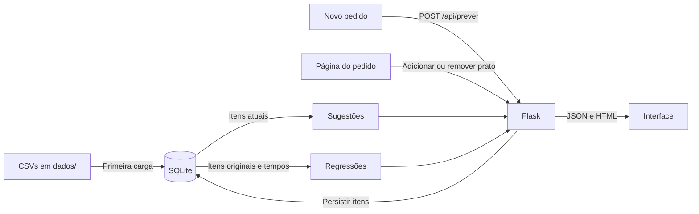

# Como o Comanda foi implementado

## 1. Objetivo e arquitetura

O Comanda ajuda um restaurante a prever o tempo de preparo dos pedidos. Ele recebe os pratos de um pedido e a fila da cozinha, estima o tempo com duas regressões lineares e exibe o resultado. Também sugere pratos que combinam com o pedido e mostra análises da base.

O projeto foi adaptado de uma plataforma de streaming e manteve a mesma estrutura:

| Streaming (antes) | Restaurante (agora) |
| --- | --- |
| Usuários com horas na plataforma e horas assistidas | Pedidos com fila da cozinha e tempo de preparo |
| Gêneros e títulos | Categorias e pratos |
| `visualizacoes` (editável) / `historico_inicial` (treino) | `itens_pedido` (editável) / `itens_originais` (treino) |
| Recomendação de títulos | Sugestão de pratos |
| Perfil do usuário | Página do pedido |
| Simulador da regressão múltipla | Página Novo pedido |

O backend usa Flask para HTTP, SQLite para persistência e NumPy para operações numéricas. O frontend é HTML, CSS e JavaScript sem framework e sem processo de build. Não há serviço externo de IA.



## 2. Dados

O diretório [dados/](../dados/) contém os CSVs, com cabeçalho, vírgula como separador e UTF-8.

| Arquivo | Colunas | Finalidade |
| --- | --- | --- |
| `pedidos.csv` | `pedido_id,cliente,pedidos_na_fila,tempo_preparo_min` | 100 pedidos com o tempo real de preparo |
| `categorias.csv` | `categoria_id,nome` | 10 categorias do cardápio |
| `pratos.csv` | `prato_id,nome,categoria_id,tempo_prato_min` | 60 pratos, 6 por categoria, com o tempo individual de preparo em minutos |
| `itens_pedido.csv` | `pedido_id,prato_id` | Pratos de cada pedido |

[preparar_dados.py](../preparar_dados.py) gera todos os arquivos com a semente `20261028`, então a mesma execução produz sempre os mesmos dados. Para cada pedido:

1. Sorteia de 1 a 8 pratos distintos. Três estilos de pedido (leve: entradas, saladas, sopas e bebidas; principal: massas, risotos e grelhados; lanche: lanches, porções e sobremesas) dão peso 9 às categorias do estilo e 0,4 às demais, para que os agrupamentos sejam observáveis.
2. Sorteia a fila da cozinha, de 0 a 12 pedidos.
3. Calcula o tempo da cozinha com os pratos em paralelo: `maior tempo + 0,35 × (soma dos tempos − maior tempo)` (`tempo_cozinha`, com `FATOR_PARALELISMO = 0,35`).
4. Calcula o tempo real: `3 + cozinha + 1,3 × fila + 0,8 × categorias + ruído`. O ruído é normal, com desvio-padrão de 2,2 min. O tempo mínimo é 3 min.

O tempo de cada prato fica no dicionário `CARDAPIO` (prato → minutos), conforme a complexidade: bebidas de 1 a 4 min, sobremesas de 2 a 7, saladas de 4 a 7, sopas, entradas e lanches de 6 a 11, porções de 9 a 15, massas de 11 a 18, grelhados de 14 a 22 e risotos de 19 a 22.

Os modelos não conhecem essa fórmula. A diferença entre o paralelismo (que depende do maior prato) e a soma usada pelos modelos, junto com o ruído, é a parte do tempo que as regressões não conseguem explicar.

A ordem dos sorteios é a mesma da versão anterior do gerador: com a mesma semente, os pratos e a fila de cada pedido são idênticos, e só o tempo real muda.

## 3. Banco e inicialização

| Tabela | Dados e relações |
| --- | --- |
| `pedidos` | ID, cliente, pedidos na fila e tempo de preparo |
| `categorias` | ID e nome |
| `pratos` | ID, nome, chave estrangeira para categoria e `tempo_prato_min` |
| `itens_pedido` | Itens editáveis; chave composta `(pedido_id, prato_id)` |
| `itens_originais` | Cópia inicial dos itens, usada pelas regressões |
| `migracoes` | Versões de carga aplicadas |

`app.criar_app()` chama `inicializar_banco()`. As tabelas usam `CREATE TABLE IF NOT EXISTS`. Em seguida, `BEGIN IMMEDIATE` serializa a carga: quando a versão 1 ainda não existe, os CSVs são inseridos, os itens são copiados para as duas tabelas e a versão é registrada na mesma transação. Nas próximas inicializações, a versão 1 impede a recarga, então itens removidos pela interface não voltam.

A **migração 2** acrescenta `pratos.tempo_prato_min REAL NOT NULL DEFAULT 0` (se a coluna ainda não existir), preenche o tempo de cada prato e atualiza `pedidos.tempo_preparo_min` com os tempos reais gerados a partir deles. Antes, ela confere que os IDs dos pratos e os itens originais são os mesmos dos CSVs; se não forem, interrompe a carga, porque os tempos novos não corresponderiam aos itens. `itens_pedido`, a tabela editável, não é tocada.

Adicionar um prato usa `INSERT OR IGNORE`; remover usa `DELETE` pelo par de IDs. Repetir qualquer operação dá o mesmo resultado (operações idempotentes).

## 4. Previsão do tempo de preparo

### Regressão simples

`ajustar_simples(x, y)` calcula `Y = B0 + B1·X + E` manualmente, em Python puro (sem NumPy), com X = tempo dos pratos (`tempo_base_itens`, soma dos tempos individuais) e Y = tempo de preparo:

```text
B1 = Σ(xi − x̄)(yi − ȳ) / Σ(xi − x̄)²
B0 = ȳ − B1·x̄
Ei = yi − (B0 + B1·xi)
R² = 1 − ΣEi² / Σ(yi − ȳ)²
```

Exige pelo menos duas observações finitas e variação em X. Com Y constante, o R² é indefinido. `comparar_polyfit(x, y)` roda o mesmo ajuste com `numpy.polyfit(x, y, 1)` e devolve os coeficientes, os dois R² e as diferenças (intercepto, coeficiente, R² e maior diferença entre previsões).

### Regressão múltipla

```text
y = β0 + β1 × tempo dos pratos + β2 × fila + β3 × categorias
```

`ajustar_modelo(x, y)` monta a matriz `[1, tempo dos pratos, fila, categorias]` e usa `numpy.linalg.lstsq`. Exige pelo menos quatro observações, valores finitos e posto 4 (variáveis linearmente independentes). Se uma variável for constante, por exemplo a mesma fila em todos os pedidos, o modelo fica indisponível e a simples continua funcionando.

### Consulta das observações

`carregar_observacoes()` junta `pedidos` com `itens_originais` e `pratos` para calcular, por pedido, a quantidade de itens, o tempo dos pratos (`tempo_base_itens = COALESCE(SUM(c.tempo_prato_min), 0)`) e as categorias distintas. `obter_analises()` devolve os resumos `simples` e `multipla` e a lista `observacoes`, com previsões brutas e resíduos (real − previsto). O erro absoluto médio é a média dos módulos dos resíduos. As métricas são calculadas na amostra de treinamento. Valores não finitos viram `null` no JSON.

### Estimativa de um pedido

`POST /api/prever` recebe `{"pratos": [ids], "pedidos_na_fila": n}`. O servidor:

1. valida a lista (não vazia, inteiros, sem repetição, pratos existentes) e a fila (inteiro de 0 a 50; aceita string numérica);
2. busca o tempo individual e a categoria de cada prato, soma os tempos (tempo base) e conta as categorias distintas;
3. chama `prever_tempo(tempo_base, fila, categorias)`.

A resposta traz `entrada`, `quantidade_itens` e, para cada modelo, `previsao_minutos` (limitada a zero), `previsao_bruta` e `calculo`, a conta com os coeficientes arredondados. Na simples, `previsao_polyfit` e `diferenca_polyfit` conferem a mesma previsão com os coeficientes do `numpy.polyfit`. Há avisos quando alguma variável sai do intervalo observado (extrapolação) ou quando a previsão bruta fica negativa. Se nenhum dos dois modelos estiver disponível, a resposta é 422.

## 5. Sugestões de pratos

As funções ficam em [recomendacao.py](../recomendacao.py) e são recalculadas a cada consulta.

- `M[p,r]`: 1 se o pedido `p` contém o prato `r`.
- `C[p,c]`: pratos da categoria `c` no pedido `p`.
- `P[p,c] = C[p,c] / soma(C[p,:])`: perfil proporcional do pedido.

A similaridade entre categorias é o cosseno das colunas de `C`; a distância é `1 − cosseno`. `agrupar()` faz agrupamento hierárquico de ligação média até três grupos, com desempate pelos IDs.

```text
A(p, r) = Σ_c P[p,c] × similaridade(c, categoria(r))
B(p, r) = Σ_v sim(p,v) × M[v,r] / Σ_v sim(p,v)     para até 5 vizinhos com similaridade positiva
```

| Situação | Pontuação |
| --- | --- |
| Itens e vizinhos | `0,5 × A + 0,5 × B` |
| Itens, sem vizinhos | `A` |
| Pedido sem itens | Pedidos com o prato / total de pedidos |

Pratos já incluídos são excluídos. O ranking ordena por pontuação, popularidade e ID e devolve até dez itens, com motivos: a categoria do pedido com maior contribuição e os pedidos semelhantes que incluíram o prato.

## 6. API

| Rota | Entrada | Saída principal |
| --- | --- | --- |
| `GET /` | Nenhuma | Visão geral |
| `GET /novo-pedido` | Nenhuma | Formulário de pedido com o cardápio |
| `GET /categorias` | Nenhuma | Ranking das categorias mais pedidas |
| `GET /cardapio` | Nenhuma | Pratos e quantos pedidos atuais os incluem |
| `GET /analises` | Nenhuma | Regressões, manual × polyfit, real × previsto e agrupamentos |
| `GET /regressao` | Nenhuma | Redireciona para `/analises#regressao` |
| `GET /pedidos/<id>` | ID do pedido | Página do pedido; 404 se inexistente |
| `POST /api/prever` | `pratos` e `pedidos_na_fila` | `entrada`, `simples`, `multipla`, `avisos` |
| `GET /api/analises` | Nenhuma | `simples`, `multipla` e `observacoes` |
| `GET /api/modelo` | Nenhuma | Resumo da regressão múltipla |
| `GET /api/pedidos` | Nenhuma | Lista com `id` e `cliente` |
| `GET /api/pratos` | Query `pedido_id` inteira | Cardápio com `tempo_prato_min` e `incluido` booleano |
| `GET /api/pedidos/<id>/sugestoes` | ID do pedido | `pedido`, `pedido_vazio`, `sugestoes`, `pedidos_semelhantes` |
| `GET /api/clusters` | Nenhuma | `grupos` e `categorias` com `proximos` |
| `PUT /api/pedidos/<id>/itens/<prato_id>` | `{"incluido": true}` ou `false` | IDs e estado confirmado |

Entradas inválidas retornam 400, IDs inexistentes retornam 404 e modelos indisponíveis ao prever retornam 422. Os erros das APIs usam `{"erro": "mensagem"}`. `incluido` exige booleano JSON real.

## 7. Frontend

`templates/base.html` centraliza a navegação: Visão geral, Novo pedido, Categorias, Cardápio e Análises.

- **Novo pedido** ([novo_pedido.js](../static/novo_pedido.js)): pratos agrupados por categoria, com o tempo de preparo ao lado de cada um, busca e filtro. O resumo ao lado mostra itens, categorias, o tempo base dos pratos (somado em tempo real a cada caixa marcada) e a lista escolhida. Ao enviar, valida a seleção e a fila, chama `POST /api/prever` e exibe a estimativa com `renderEstimativa` ([common.js](../static/common.js)). Mudar a seleção apaga o resultado anterior, para que ele não pareça valer para outra composição.
- **Página do pedido** ([script.js](../static/script.js)): dados do registro (incluindo o tempo base dos pratos registrado e o atual), tempo previsto pelos dois modelos e estimativa para os itens atuais, recalculada após cada alteração. As abas Sugestões, Cardápio e Itens do pedido permitem adicionar e remover pratos; um contador de requisições descarta respostas antigas.
- **Análises**: gráficos SVG gerados localmente ([graficos.js](../static/graficos.js)). A dispersão da simples tem no eixo X o tempo dos pratos (min) e no eixo Y o tempo de preparo; o valor exato de cada ponto aparece ao passar o mouse e na tabela de pedidos, que também tem a coluna do tempo dos pratos.

## 8. Limites da demonstração

Os pedidos e os tempos são sintéticos. O modelo considera a soma dos tempos dos pratos, a fila e as categorias. Ele não sabe qual é o prato mais demorado do pedido, que é o que define o paralelismo, quantos cozinheiros estão trabalhando nem o horário. Por isso superestima pedidos com muitos pratos rápidos. Cada prato aparece no máximo uma vez por pedido. As métricas são calculadas na amostra de treinamento, sem validação em pedidos novos. A página Novo pedido calcula a estimativa, mas não grava o pedido. A aplicação usa o servidor de desenvolvimento do Flask.
