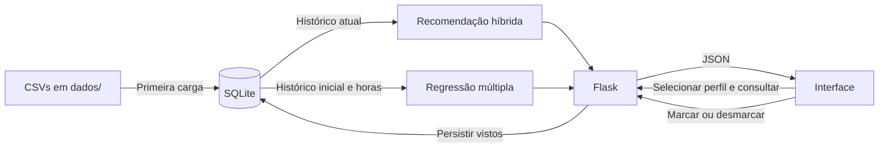

# Como o StreamData foi implementado

## 1. Objetivo e arquitetura

O projeto começou como uma demonstração de regressão linear simples sobre horas na plataforma e horas assistidas. A versão atual reúne um painel Admin de análise global, regressões simples e múltipla para estimar engajamento e perfis individuais com recomendações de títulos ainda não vistos.

Os usuários, títulos e gêneros são fixos. Abrir um nome na tabela leva ao perfil individual; não é login. A única alteração de dados disponível pela interface é marcar ou desmarcar um conteúdo como visto.

O backend usa Flask para HTTP, SQLite para persistência e NumPy para operações numéricas. O frontend é HTML, CSS e JavaScript sem framework e sem processo de build. Não há serviço externo de IA nem modelo de linguagem no recomendador.



## 2. Arquivos de dados

O diretório [dados/](../dados/) contém todos os CSVs. Os quatro arquivos ativos usam cabeçalho, vírgula como separador e UTF-8; IDs são inteiros e horas usam ponto decimal.

| Arquivo | Colunas | Finalidade |
| --- | --- | --- |
| `dataset_streaming.csv` | `usuario_id,nome,tempo_plataforma_horas,tempo_assistindo_horas` | 100 usuários; IDs e horas originais, com nomes fictícios |
| `generos.csv` | `genero_id,nome` | 10 gêneros |
| `conteudos.csv` | `conteudo_id,titulo,genero_id` | 60 títulos; um gênero principal por título |
| `historico_inicial.csv` | `usuario_id,conteudo_id` | Relações de conteúdos vistos na amostra inicial |
| `Dataset Streaming(Planilha1).csv` | `Usuário,Tempo de uso (X),Tempo assistindo (Y)` | Referência original; não é lida pela aplicação |

`banco.DIRETORIO_DADOS` centraliza o caminho, calculado com `Path(__file__).resolve().parent / 'dados'`. O gerador também usa essa constante. O diretório corrente do terminal não define a localização dos CSVs.

### Geração demonstrativa

`preparar_dados.py` lê os IDs e horas do dataset existente, produz nomes e histórico e sobrescreve apenas os CSVs de usuários e histórico; o catálogo de filmes e os gêneros são preservados. Não é executado automaticamente. Não gera os dados originais de horas do zero.

A semente `20261027` torna a geração reproduzível com a mesma entrada. Cada usuário com histórico recebe de 3 a 17 títulos distintos. Três conjuntos de preferências aumentam o peso de seleção de determinados gêneros: peso 9 dentro da preferência e 0,4 fora dela. Os IDs 20, 40, 60, 80 e 100 começam sem histórico.

Esses conjuntos servem apenas para fabricar uma amostra com padrões. Os clusters exibidos na aplicação são calculados pelo consumo e não copiam diretamente esses conjuntos.

## 3. Banco e inicialização

| Tabela | Dados e relações |
| --- | --- |
| `usuarios` | ID, nome e as duas medidas de horas |
| `generos` | ID e nome |
| `conteudos` | ID, título e chave estrangeira para gênero |
| `visualizacoes` | Histórico editável; chave composta `(usuario_id, conteudo_id)` |
| `historico_inicial` | Cópia inicial dos vistos, usada pela regressão |
| `migracoes` | Versões de carga aplicadas; atualmente versões 1 e 2 |

A tabela antiga `engajamento`, quando presente, é preservada, mas não alimenta os cálculos atuais.

`app.criar_app()` chama `inicializar_banco()`. O módulo também cria `app` ao ser importado, garantindo inicialização no uso via WSGI. A criação de tabelas usa `CREATE TABLE IF NOT EXISTS`. Em seguida, `BEGIN IMMEDIATE` serializa a carga: quando a versão 1 ainda não existe, os CSVs são inseridos, os vistos são copiados para as duas tabelas de histórico e a versão é registrada na mesma transação.

Em próximas inicializações, a versão 1 impede recarga dos históricos. A versão 2 atualiza títulos e gêneros pelos mesmos IDs, usando os 60 filmes selecionados da lista do usuário. Ela preserva os pares de ambos os históricos; a mudança de gênero pode alterar os coeficientes da regressão, pois o gênero é consultado no catálogo atual. Portanto, alterações nos CSVs não atualizam automaticamente um banco já carregado. Isso evita restaurar um conteúdo desmarcado ou apagar novas marcações.

As conexões habilitam chaves estrangeiras e retornam `sqlite3.Row`. A classe `Conexao` fecha a conexão ao sair do bloco `with`, depois do commit ou rollback, evitando arquivos presos no Windows.

Marcar um conteúdo usa `INSERT OR IGNORE`; desmarcar usa `DELETE` pelo par de IDs. Repetir qualquer operação mantém o mesmo resultado: são operações idempotentes.

## 4. Recomendação passo a passo

As funções ficam em [recomendacao.py](../recomendacao.py). Os cálculos são refeitos nas consultas; não há treinamento persistido ou cache de ranking.

### Matrizes e perfis

- `M[u,c]`: 1 se o usuário `u` viu o conteúdo `c`, senão 0.
- `C[u,g]`: quantidade de conteúdos do gênero `g` vistos por `u`.
- `P[u,g]`: `C[u,g] / soma(C[u,:])`, ou zero quando o histórico está vazio.

Exemplo: um usuário com três títulos de ação e um de aventura tem perfil proporcional de 0,75 para ação e 0,25 para aventura. Os IDs são mapeados para índices; não é necessário que ID e posição na matriz coincidam.

### Proximidade de gêneros

Cada gênero é representado pela coluna de `C`, isto é, suas contagens de consumo entre todos os usuários. A similaridade é:

```text
cos(a,b) = produto_escalar(a,b) / (norma(a) × norma(b))
distância(a,b) = 1 − cos(a,b)
```

Vetores nulos produzem similaridade zero. O código limita resultados ao intervalo de 0 a 1 para eliminar desvios numéricos. Gêneros ficam próximos quando suas contagens entre usuários seguem padrões proporcionais; não é uma análise semântica dos nomes dos gêneros.

### Agrupamento hierárquico

Cada gênero começa sozinho. `agrupar()` calcula a média das distâncias de todos os pares entre dois grupos e une o par com a menor média. O processo termina com três grupos. Empates são resolvidos pelas tuplas de IDs dos grupos.

A API também retorna, para cada gênero, todos os outros ordenados por distância e ID. A ordenação usa as distâncias originais entre gêneros. Pertencer ao mesmo cluster não é requisito para receber uma recomendação.

### Afinidade por gênero e usuários semelhantes

A afinidade de um título é:

```text
A(u,c) = soma, para cada gênero g, de P[u,g] × similaridade(g, gênero(c))
```

A comparação entre usuários usa cosseno de seus perfis `P`. São escolhidos até cinco vizinhos com similaridade positiva, excluindo o próprio usuário. Empates seguem o ID do usuário.

O componente colaborativo é:

```text
B(u,c) = soma(similaridade(u,v) × M[v,c]) / soma(similaridade(u,v))
          para os vizinhos v selecionados
```

Usuários podem ser semelhantes por consumirem os mesmos gêneros mesmo sem terem visto os mesmos títulos. Já a contribuição colaborativa depende de o vizinho ter visto exatamente o título candidato.

### Ranking e exceções

| Situação | Pontuação |
| --- | --- |
| Histórico e vizinhos válidos | `0,5 × A + 0,5 × B` |
| Histórico, sem vizinhos válidos | `A` |
| Sem histórico | Número de usuários que viram o título dividido pelo total de usuários |

Exemplo ilustrativo: afinidade 0,8 e componente colaborativo 0,6 resultam em pontuação 0,7. Isso não significa 70% de chance de gostar.

Títulos vistos são sempre excluídos. O ranking ordena por pontuação decrescente, popularidade decrescente e ID crescente, retornando até dez itens. Se todo o catálogo já foi visto, a lista fica vazia. Candidatos sem afinidade ainda podem aparecer ao completar a lista, com explicação de exploração do catálogo.

Cada item informa afinidade, componente colaborativo, popularidade, pontuação final e motivos. Os motivos citam o gênero com maior contribuição ou os vizinhos que realmente viram o título; usuários sem histórico recebem explicação por popularidade.

## 5. Regressões e comparação dos modelos

### Regressão simples e visão conjunta

`ajustar_simples(x, y)` ajusta `Y = B0 + B1·X + E`, em que Y são as horas assistidas (variável dependente), X são as horas na plataforma (variável independente), B0 é o intercepto, B1 é o coeficiente angular e E é o erro. O cálculo é manual, por mínimos quadrados:

```text
B1 = Σ(xi − x̄)(yi − ȳ) / Σ(xi − x̄)²
B0 = ȳ − B1·x̄
Ei = yi − (B0 + B1·xi)
```

Os erros Ei alimentam o R². A função exige pelo menos duas observações finitas e variação em X, pois sem ela o denominador de B1 é zero. Com Y constante, R² é indefinido. A indisponibilidade de um modelo não impede a apresentação do outro.

`obter_analises()` consulta todos os usuários, incluindo quem não possui histórico, e devolve os resumos `simples` e `multipla` e a lista `observacoes`. Cada observação contém ID, nome, horas, contagens iniciais, previsões brutas e resíduos. Resíduo é observado menos previsto; erro absoluto médio é a média dos módulos desses resíduos. As métricas são calculadas na mesma amostra de treinamento, sem alegação de desempenho fora dela. Valores e previsões indisponíveis são `null` na API.

O primeiro commit disponível (`ccfe2f1`) já continha regressão múltipla. A regressão simples foi reconstruída a partir das horas originais preservadas, em conformidade com a proposta descrita na documentação; não foi recuperada de código anterior inexistente no histórico Git.

### Regressão múltipla

[regressao.py](../regressao.py) implementa uma análise separada. Ela não calcula a ordem das recomendações.

```text
y = β0 + β1 × horas_na_plataforma
       + β2 × quantidade_vistos
       + β3 × quantidade_generos
```

O alvo `y` são as horas assistidas originais. As contagens vêm de `historico_inicial`, com junções à esquerda para manter usuários sem histórico. A matriz de projeto tem quatro colunas: intercepto e três variáveis. `numpy.linalg.lstsq` calcula os coeficientes por mínimos quadrados.

O ajuste exige pelo menos quatro observações, valores finitos e posto 4. Posto insuficiente significa que não há independência suficiente para estimar os quatro coeficientes. O resumo sinaliza indisponibilidade nesses casos.

`R² = 1 − soma_dos_resíduos² / soma_dos_desvios_do_alvo²`. Quando o alvo é constante, retorna `null` em JSON. É uma medida do ajuste na própria amostra, não uma avaliação com usuários novos.

A previsão informa o valor bruto e um valor para exibição limitado entre zero e as horas na plataforma. Há avisos quando ocorre limitação ou alguma entrada fica fora dos intervalos observados. As contagens são históricas e as horas são diárias; não se assume duração de cada filme nem consumo de todos os filmes em um dia.

## 6. API e fluxo de interação

| Rota | Entrada | Saída principal |
| --- | --- | --- |
| `GET /` | Nenhuma | HTML da interface |
| `GET /categorias` | Nenhuma | Gráfico de categorias mais assistidas por todos os usuários |
| `GET /catalogo` | Nenhuma | Catálogo global com audiência atual por título |
| `GET /analises` | Nenhuma | Gráficos, comparação, simulador e clusters |
| `GET /regressao` | Nenhuma | Redireciona para `/analises#regressao` |
| `GET /usuarios/<id>` | ID do usuário | Perfil individual; página 404 se inexistente |
| `GET /api/analises` | Nenhuma | `simples`, `multipla` e `observacoes`, com previsões, resíduos e erro absoluto médio |
| `GET /api/usuarios` | Nenhuma | Lista com `id` e `nome` |
| `GET /api/conteudos` | Query `usuario_id` inteira | Catálogo com gênero e `visto` booleano |
| `GET /api/usuarios/<id>/recomendacoes` | ID do usuário | `usuario`, `sem_historico`, `recomendacoes`, `usuarios_semelhantes` |
| `GET /api/clusters` | Nenhuma | `grupos` e `generos`, com vizinhos ordenados em `proximos` |
| `PUT /api/usuarios/<id>/vistos/<conteudo_id>` | `{"visto": true}` ou `{"visto": false}` | IDs e estado confirmado |
| `GET /api/modelo` | Nenhuma | Disponibilidade, amostra, fórmula, coeficientes, R² e intervalos |
| `POST /api/prever` | Três variáveis | `previsao_horas`, `previsao_bruta`, `formula`, `avisos` |

Exemplo de entrada para previsão:

```json
{"tempo_plataforma": 4, "quantidade_vistos": 10, "quantidade_generos": 3}
```

Entradas inválidas retornam 400, IDs não encontrados nas rotas de consulta/marcação retornam 404 e modelo indisponível ao prever retorna 422. Os erros tratados das APIs usam `{"erro": "mensagem"}`. Páginas ou rotas inexistentes recebem uma página HTML 404 com link para o Admin.

Horas precisam ser finitas, maiores que zero e no máximo 24. Contagens precisam ser inteiras e não negativas, limitadas ao catálogo; gêneros não podem superar a quantidade de vistos. Com vistos positivos, a quantidade de gêneros também deve ser positiva. A API aceita números ou strings numéricas para a previsão, mas rejeita booleanos; `visto` exige booleano JSON real.

## 7. Frontend e painel Admin

A página inicial é o painel **Admin**, sem autenticação. A navegação compartilhada oferece Visão geral, Categorias mais assistidas, Catálogo e Análises. Os perfis são páginas individuais em `/usuarios/<id>`; IDs inexistentes recebem uma página 404 com acesso ao painel.

A visão geral calcula totais de usuários, conteúdos, gêneros e marcações atuais, além das médias de horas no banco. Exibe a regressão simples e uma tabela pesquisável por nome ou ID com acesso aos perfis. O catálogo global mostra o número atual de usuários que assistiram a cada título, com busca e filtro por gênero. Sua consulta é compartilhada com a API de catálogo individual, cujo contrato continua exigindo `usuario_id`.

A página Análises reúne a regressão simples, comparações observado × previsto dos dois modelos em escalas iguais, simulador múltiplo e agrupamentos de gêneros. Os gráficos são SVG, gerados localmente sem bibliotecas externas. Pontos têm links, nomes e valores consultáveis por mouse ou teclado. Uma tabela apresenta os mesmos dados, previsões brutas e resíduos. Em telas pequenas, tabelas e gráficos podem rolar horizontalmente para manter os textos legíveis.

Cada perfil mostra horas observadas, previsões e resíduos de ambos os modelos, contagens iniciais usadas no treinamento e contagens atuais editáveis. As abas Para você, Catálogo e Já assistidos mantêm recomendações, explicações, vizinhos e ações de marcar/desmarcar. O ID da URL identifica o perfil, sem seleção global implícita. As abas mantêm seleção ARIA e navegação por setas, Home e End.

`templates/base.html` centraliza a navegação e o tema. `static/common.js` fornece formatação, escape e consultas HTTP; `script.js` controla apenas o perfil; `analises.js` controla o simulador e clusters; `graficos.js` desenha os SVGs; `tabelas.js` filtra as tabelas. Os scripts são carregados somente nas páginas que usam seus elementos.

Ao marcar/desmarcar, o frontend espera a confirmação do PUT e recarrega o catálogo e as recomendações do perfil. Recalcula os indicadores atuais e restaura o foco. As contagens iniciais e as previsões permanecem inalteradas. Os agregados globais refletem as mudanças no próximo acesso à página. Estados de carregamento e erros usam mensagens acessíveis; respostas antigas são descartadas pelo contador de requisições.

## 8. Limites da demonstração

A página `/categorias`, acessível pelo link na página inicial, apresenta barras horizontais por gênero em ordem decrescente de marcações. A consulta agrega o histórico atual de `visualizacoes`, incluindo gêneros com contagem zero. Cada par usuário/conteúdo conta uma vez; o percentual usa o total de marcações e a largura das barras usa a maior contagem. O HTML é renderizado no servidor sem biblioteca externa, atualizado a cada acesso. Sem marcações, apresenta uma mensagem de estado vazio.

Não há autenticação, cadastro, notas, reprodução de vídeo ou avaliação de satisfação. A marcação é um sinal implícito de consumo. Títulos têm somente um gênero principal. Similaridades e clusters refletem os padrões sintéticos desta base.

Os cálculos em memória e a recomputação a cada consulta atendem ao catálogo pequeno, mas não foram projetados para escala de produção. A aplicação usa servidor de desenvolvimento ao executar `app.py`. A regressão não foi validada em uma amostra externa, e as horas originais não foram geradas a partir dos históricos novos.
