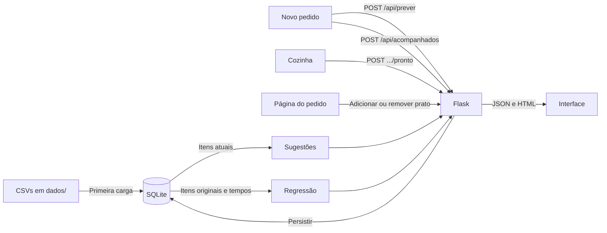

# Como o Comanda foi implementado

## 1. Objetivo e arquitetura

O Comanda ajuda um restaurante a prever o tempo de preparo dos pedidos. Ele recebe os pratos de um pedido e a fila da cozinha, estima o tempo com uma regressão linear múltipla e exibe o resultado. Também acompanha pedidos novos até ficarem prontos (previsão × realidade), sugere pratos que combinam com o pedido e mostra análises da base.

O projeto foi adaptado de uma plataforma de streaming e manteve a mesma estrutura:

| Streaming (antes) | Restaurante (agora) |
| --- | --- |
| Usuários com horas na plataforma e horas assistidas | Pedidos com fila da cozinha e tempo de preparo |
| Gêneros e títulos | Categorias e pratos |
| `visualizacoes` (editável) / `historico_inicial` (treino) | `itens_pedido` (editável) / `itens_originais` (treino) |
| Recomendação de títulos | Sugestão de pratos |
| Perfil do usuário | Página do pedido |
| Simulador da regressão múltipla | Página Novo pedido |

O backend usa Flask para HTTP, SQLite para persistência e NumPy para operações numéricas. O frontend é HTML, CSS e JavaScript sem framework e sem processo de build. Não há serviço externo de IA.



### Organização do código

O backend é o pacote [comanda/](../comanda/), dividido em camadas. Cada camada só importa as de baixo:

```text
web/            páginas, API, validação, consultas de leitura, filtros          (Flask)
acompanhamento  pedidos enviados à Cozinha                                       ┐
recomendacao    sugestões e agrupamentos                                         │ regras do domínio
modelo/         regressão, β personalizados, previsão                            │
cozinha, dados  regra sintética da cozinha e geração dos CSVs                    ┘
db, migracoes   conexão SQLite, esquema e migrações                              (persistência)
```

- `modelo/minimos_quadrados.py` não conhece o banco: recebe listas X e y e devolve os β. É a parte a estudar para entender a regressão.
- `modelo/variaveis.py` define as quatro variáveis e `aplicar(coeficientes, valores)`, a única função que calcula `β0 + Σ βi·xi`. O R², as análises e as previsões usam essa função.
- `cozinha.py` guarda a regra que gerou o histórico. `dados.py` a usa para gerar os CSVs, e `acompanhamento.py`, para sortear o tempo real dos pedidos novos. Por isso, os dois ficam sempre comparáveis.
- `web/` é a única camada que conhece o Flask. O resto pode ser usado no terminal (`gerenciar.py`) ou nos testes sem servidor.

[app.py](../app.py) só chama `comanda.criar_app()`. Esse `criar_app()`:
1. roda `inicializar_banco()`;
2. cria o Flask com a raiz do projeto como `root_path`, para que `templates/` e `static/` continuem na raiz;
3. registra os filtros (`web/formatacao.py`) e os blueprints `paginas` e `api`.

## 2. Dados

O diretório [dados/](../dados/) contém os CSVs, com cabeçalho, vírgula como separador e UTF-8.

| Arquivo | Colunas | Finalidade |
| --- | --- | --- |
| `pedidos.csv` | `pedido_id,cliente,pedidos_na_fila,tempo_preparo_min` | 100 pedidos com o tempo real de preparo |
| `categorias.csv` | `categoria_id,nome` | 10 categorias do cardápio |
| `pratos.csv` | `prato_id,nome,categoria_id,tempo_prato_min` | 60 pratos, 6 por categoria, com o tempo individual de preparo em minutos |
| `itens_pedido.csv` | `pedido_id,prato_id` | Pratos de cada pedido |

[comanda/dados.py](../comanda/dados.py) (`python gerenciar.py dados`) gera todos os arquivos com a semente `20261028`, então a mesma execução produz sempre os mesmos dados. Para cada pedido:

1. Sorteia de 1 a 8 pratos distintos (`cozinha.sortear_pratos`). Três estilos de pedido (leve: entradas, saladas, sopas e bebidas; principal: massas, risotos e grelhados; lanche: lanches, porções e sobremesas; `GRUPOS`) dão peso 9 às categorias do estilo e 0,4 às demais, para que os agrupamentos sejam observáveis.
2. Sorteia a fila da cozinha, de 0 a 12 pedidos.
3. Calcula o tempo da cozinha com os pratos em paralelo: `maior tempo + 0,35 × (soma dos tempos − maior tempo)` (`cozinha.tempo_cozinha`, com `FATOR_PARALELISMO = 0,35`).
4. Calcula o tempo real: `3 + cozinha + 1,3 × fila + 0,8 × categorias + ruído` (`cozinha.tempo_real`). O ruído é normal, com desvio-padrão `DESVIO_RUIDO = 3,7` min, calibrado para que o modelo correto reduza o erro em ~75–76% em pedidos não vistos. O tempo mínimo é 3 min.

O tempo de cada prato fica no dicionário `CARDAPIO` de [comanda/cozinha.py](../comanda/cozinha.py) (prato → minutos), conforme a complexidade: bebidas de 1 a 4 min, sobremesas de 2 a 7, saladas de 4 a 7, sopas, entradas e lanches de 6 a 11, porções de 9 a 15, massas de 11 a 18, grelhados de 14 a 22 e risotos de 19 a 22.

O modelo não conhece essa fórmula. Com o maior prato e os demais pratos separados, o modelo captura o paralelismo; a parte que ele não explica é o ruído.

A ordem dos sorteios é a mesma da versão anterior do gerador: com a mesma semente, os pratos e a fila de cada pedido são idênticos, e só o tempo real muda.

## 3. Banco e inicialização

| Tabela | Dados e relações |
| --- | --- |
| `pedidos` | ID, cliente, pedidos na fila e tempo de preparo |
| `categorias` | ID e nome |
| `pratos` | ID, nome, chave estrangeira para categoria e `tempo_prato_min` |
| `itens_pedido` | Itens editáveis; chave composta `(pedido_id, prato_id)` |
| `itens_originais` | Cópia inicial dos itens, usada pela regressão |
| `pedidos_acompanhados` | Pedidos novos enviados à cozinha: horários, variáveis, previsão gravada, `tempo_sorteado_min` (modo simulado: sorteado no envio), `tempo_real_min` e `origem_tempo` (`simulado` ou `relogio`) |
| `pedidos_acompanhados_itens` | Pratos de cada pedido acompanhado |
| `coeficientes_personalizados` | β definidos pelo usuário (`nome`, `valor`); vazia = valem os β calculados |
| `migracoes` | Versões de carga aplicadas |

[comanda/db.py](../comanda/db.py) guarda os caminhos (`CAMINHO_BANCO`, `DIRETORIO_DADOS`) e `conectar()`. A conexão fecha ao sair do `with`, com commit ou rollback. Os testes trocam `comanda.db.CAMINHO_BANCO` por um banco temporário.

`inicializar_banco()` ([comanda/migracoes.py](../comanda/migracoes.py)) segue estes passos:
1. Cria as tabelas com `CREATE TABLE IF NOT EXISTS`.
2. Acrescenta as colunas que faltam em `pedidos_acompanhados`.
3. Serializa a carga com `BEGIN IMMEDIATE`.
4. Completa o tempo real de pedidos da Cozinha concluídos antes dessas colunas (pelo relógio).
5. Aplica as migrações pendentes da lista `MIGRACOES`, cada uma registrada em `migracoes` na mesma transação.

- **Migração 1:** carrega os CSVs e copia os itens para `itens_pedido` e `itens_originais`. Como fica registrada, as próximas inicializações não recarregam, e itens removidos pela interface não voltam.
- **Migração 2:** acrescenta `pratos.tempo_prato_min`, se a coluna ainda não existir, preenche o tempo de cada prato e atualiza `pedidos.tempo_preparo_min` com os tempos reais gerados a partir deles.
- **Migração 3:** regrava `pedidos.tempo_preparo_min` com os tempos do ruído calibrado.

As migrações 2 e 3 conferem antes que os IDs dos pratos e os itens originais são os mesmos dos CSVs. Se não forem, interrompem a carga, porque os tempos novos não corresponderiam aos itens. `itens_pedido`, a tabela editável, não é tocada.

`resetar_banco()` apaga o arquivo e roda `inicializar_banco()` de novo; `gerenciar.py resetar` pede confirmação antes. No Windows, o arquivo fica travado enquanto o servidor roda, e o reset avisa isso.

Adicionar um prato usa `INSERT OR IGNORE`; remover usa `DELETE` pelo par de IDs. Repetir qualquer operação dá o mesmo resultado (operações idempotentes).

## 4. Previsão do tempo de preparo

### Regressão múltipla

```text
y = β0 + β1 × maior prato + β2 × demais pratos + β3 × fila + β4 × categorias
```

Em [comanda/modelo/minimos_quadrados.py](../comanda/modelo/minimos_quadrados.py):

- `ajustar_modelo_manual(x, y)` calcula os coeficientes em Python puro, sem NumPy:
  - monta a matriz `[1, x1, …, xk]`, forma as equações normais `(XᵀX)·β = Xᵀy` com laços e as resolve por eliminação de Gauss com pivoteamento parcial (`_resolver_gauss`);
  - funciona para qualquer número de variáveis;
  - o R² é `1 − ΣEi² / Σ(yi − ȳ)²` e fica indefinido com Y constante;
  - exige mais observações finitas que variáveis. Um pivô quase zero indica variáveis dependentes e torna o modelo indisponível.
- `ajustar_modelo(x, y)` faz o mesmo ajuste com `numpy.linalg.lstsq` e confere o posto.
- `comparar_numpy(x, y, nomes)` roda os dois e devolve os coeficientes, os dois R² e as diferenças: cada coeficiente, o R² e a maior diferença entre previsões.

O resultado oficial é o manual; o NumPy é a conferência.

### Consulta das observações

`carregar_observacoes()` ([comanda/modelo/previsao.py](../comanda/modelo/previsao.py)) junta `pedidos` com `itens_originais` e `pratos` para montar uma linha por pedido:

```sql
SELECT p.id, p.cliente, p.pedidos_na_fila,
       p.tempo_preparo_min                    AS tempo_preparo,          -- Y
       COUNT(i.prato_id)                      AS quantidade_itens,       -- só exibida
       COALESCE(SUM(c.tempo_prato_min), 0)    AS tempo_base_itens,       -- só exibida
       COALESCE(MAX(c.tempo_prato_min), 0)    AS tempo_maior_prato,      -- X1
       COALESCE(SUM(c.tempo_prato_min) - MAX(c.tempo_prato_min), 0) AS tempo_demais_pratos,  -- X2
       COUNT(DISTINCT c.categoria_id)         AS quantidade_categorias   -- X4 (X3 = pedidos_na_fila)
FROM pedidos p
LEFT JOIN itens_originais i ON i.pedido_id = p.id
LEFT JOIN pratos c          ON c.id = i.prato_id
GROUP BY p.id ORDER BY p.id
```

`obter_resumo_modelo()` ajusta o modelo e decide os β em uso. Se `coeficientes_personalizados` (`modelo/coeficientes.py`) tiver os cinco β, valem eles; senão, valem os calculados.

`obter_analises()` devolve:
- o resumo `multipla`, com `comparacao_numpy`;
- a lista `observacoes`, com a previsão bruta e o resíduo (real − previsto) de cada pedido;
- o erro absoluto médio, que é a média dos módulos dos resíduos.

Valores não finitos viram `null` no JSON.

### Estimativa de um pedido

`POST /api/prever` recebe `{"pratos": [ids], "pedidos_na_fila": n}`. O servidor:

1. valida a lista (não vazia, inteiros, sem repetição, pratos existentes) e a fila (inteiro de 0 a 50; aceita string numérica) em `web/validacao.ler_pedido`. Esse passo também busca o tempo individual e a categoria de cada prato e conta as categorias distintas;
2. chama `prever_tempo(tempos, fila, categorias)`, que separa o maior prato e os demais (`variaveis_do_pedido`) e aplica os β em uso.

A resposta traz:
- `entrada`, com as quatro variáveis, `tempo_base_itens` e `quantidade_itens`;
- `multipla`, com:
  - `previsao_minutos`, limitada a zero, e `previsao_bruta`;
  - `calculo`, a conta com os coeficientes arredondados;
  - `previsao_numpy` e `diferenca_numpy`, que conferem a mesma previsão com os coeficientes do `numpy.linalg.lstsq`.

Há avisos quando alguma variável sai do intervalo observado (extrapolação) ou quando a previsão bruta fica negativa. Se o modelo estiver indisponível, a resposta é 422.

### Pedidos acompanhados

[comanda/acompanhamento.py](../comanda/acompanhamento.py) cuida dos pedidos enviados à Cozinha.

- **`registrar`** grava o pedido com a previsão do momento. No modo `simulado`, já sorteia o tempo real com `cozinha.tempo_real` e o guarda em `tempo_sorteado_min`.
- **`marcar_pronto`** conclui o pedido. Recusa com `AindaEmPreparo` (409) enquanto o relógio acelerado (`ACELERACAO_SIMULACAO = 120`) não alcançou o tempo sorteado.
- **`simular`** cria e conclui pedidos sorteados como os do histórico.
- **`resumo`** devolve o que está em preparo, os concluídos, o erro absoluto médio e o viés.

O relógio fica em `agora()`, que os testes substituem.

## 5. Sugestões de pratos

As funções ficam em [comanda/recomendacao.py](../comanda/recomendacao.py) e são recalculadas a cada consulta.

- `M[p,r]`: 1 se o pedido `p` contém o prato `r`.
- `C[p,c]`: pratos da categoria `c` no pedido `p`.
- `P[p,c] = C[p,c] / soma(C[p,:])`: perfil proporcional do pedido.

A similaridade entre categorias é o cosseno das colunas de `C`; a distância é `1 − cosseno`. `agrupar()` faz agrupamento hierárquico de ligação média até três grupos, com desempate pelos IDs.

```text
A(p, r) = Σ_c P[p,c] × similaridade(c, categoria(r))
B(p, r) = Σ_v sim(p,v) × M[v,r] / Σ_v sim(p,v)     para até 5 vizinhos com similaridade positiva
```

| Situação | Pontuação |
| --- | --- |
| Itens e vizinhos | `0,5 × A + 0,5 × B` |
| Itens, sem vizinhos | `A` |
| Pedido sem itens | Pedidos com o prato / total de pedidos |

Pratos já incluídos são excluídos. O ranking ordena por pontuação, popularidade e ID e devolve até dez itens, com motivos: a categoria do pedido com maior contribuição e os pedidos semelhantes que incluíram o prato.

## 6. Rotas

As páginas ficam em [comanda/web/paginas.py](../comanda/web/paginas.py) (blueprint `paginas`). A API fica em [comanda/web/api.py](../comanda/web/api.py) (blueprint `api`, prefixo `/api`).

| Rota | Entrada | Saída principal |
| --- | --- | --- |
| `GET /` | Nenhuma | Início: em preparo agora, saúde do modelo e índice |
| `GET /novo-pedido` | Nenhuma | Formulário de pedido com o cardápio e a fila atual |
| `GET /cozinha` | Query opcional `novo=<id>` | Pedidos em preparo (cronômetro e Pronto) e concluídos recentemente |
| `GET /analises` | Nenhuma | Real × previsto, previsão × realidade, coeficientes, manual × lstsq e agrupamentos |
| `GET /cardapio` | Nenhuma | Pratos, quantos pedidos atuais os incluem e o ranking de categorias |
| `GET /historico` | Nenhuma | Os 100 pedidos de treino com previsão e resíduo |
| `GET /categorias` | Nenhuma | Ranking das categorias mais pedidas (o mesmo do Cardápio) |
| `GET /regressao` | Nenhuma | Redireciona para `/analises#regressao` |
| `GET /pedidos/<id>` | ID do pedido | Página do pedido; 404 se inexistente |
| `POST /api/prever` | `pratos` e `pedidos_na_fila` | `entrada`, `quantidade_itens`, `multipla`, `avisos` |
| `GET /api/analises` | Nenhuma | `multipla` e `observacoes` |
| `GET /api/modelo` | Nenhuma | Resumo da regressão múltipla |
| `GET /api/coeficientes` | Nenhuma | `calculados`, `em_uso`, `personalizado`, `r_quadrado`, `r_quadrado_calculado` |
| `PUT /api/coeficientes` | Os cinco β, números com \|β\| ≤ 1000 | Mesmo formato do GET; os β passam a valer em todo o sistema |
| `DELETE /api/coeficientes` | Nenhuma | Volta aos β calculados |
| `POST /api/acompanhados` | `pratos` e `pedidos_na_fila` | Pedido acompanhado criado (201), com `previsao_min` e `criado_em` |
| `POST /api/acompanhados/simular` | `quantidade` (1 a 50, padrão 10) | `criados` e o `resumo` atualizado (201) |
| `POST /api/acompanhados/<id>/pronto` | Nenhuma | Pedido com `tempo_real_min` e `erro_min`; 404 se não existir, 409 se já pronto ou, no modo simulado, se a cozinha ainda não terminou |
| `GET /api/acompanhados` | Nenhuma | `em_preparo`, `concluidos`, `quantidade`, `erro_absoluto_medio`, `vies_medio` |
| `GET /api/pedidos` | Nenhuma | Lista com `id` e `cliente` |
| `GET /api/pratos` | Query `pedido_id` inteira | Cardápio com `tempo_prato_min` e `incluido` booleano |
| `GET /api/pedidos/<id>/sugestoes` | ID do pedido | `pedido`, `pedido_vazio`, `sugestoes`, `pedidos_semelhantes` |
| `GET /api/clusters` | Nenhuma | `grupos` e `categorias` com `proximos` |
| `PUT /api/pedidos/<id>/itens/<prato_id>` | `{"incluido": true}` ou `false` | IDs e estado confirmado |

Os códigos de erro seguem o mesmo padrão em toda a API:
- **400:** entrada inválida. As funções de `web/validacao.py` lançam `EntradaInvalida`, e o handler do blueprint a transforma nessa resposta.
- **404:** ID inexistente.
- **422:** modelo indisponível ao prever.

Os erros usam `{"erro": "mensagem"}`. `incluido` exige um booleano JSON de verdade.

## 7. Frontend

`templates/base.html` centraliza a navegação, organizada por tarefa em três grupos: **Operação** (Início, Novo pedido, Cozinha), **Modelo** (Análises) e **Referência** (Cardápio, Histórico).

- **Novo pedido** ([novo_pedido.js](../static/novo_pedido.js)):
  - pratos agrupados por categoria, com o tempo de preparo ao lado de cada um, busca e filtro;
  - a cada prato marcado, a estimativa é recalculada **ao vivo** (`POST /api/prever`, com espera de 200 ms e descarte de respostas antigas);
  - a fila vem preenchida com os pedidos em preparo;
  - "Como calculamos" (recolhível) mostra itens, categorias, tempo base, maior prato e a conta;
  - o único botão, **Enviar para a cozinha**, grava o pedido (`POST /api/acompanhados`) e leva a `/cozinha?novo=<id>`, que destaca o pedido.
- **Cozinha** ([cozinha.js](../static/cozinha.js)):
  - o cronômetro acelerado corre até o tempo sorteado e libera o botão **Pronto**;
  - fica vermelho quando passa do previsto;
  - **Simular 10 pedidos** chama `POST /api/acompanhados/simular`.
- **Página do pedido** ([script.js](../static/script.js)):
  - dados do registro, incluindo o tempo base dos pratos registrado e o atual;
  - o tempo previsto pelo modelo e a estimativa para os itens atuais, recalculada após cada alteração;
  - as abas Sugestões, Cardápio e Itens do pedido permitem adicionar e remover pratos;
  - um contador de requisições descarta respostas antigas.
- **Análises**:
  - gráficos SVG gerados localmente ([graficos.js](../static/graficos.js)). O gráfico real × previsto tem no eixo X o tempo real e no eixo Y o tempo previsto, na mesma escala, com a diagonal y = x. Os pedidos novos aparecem como losangos;
  - a edição dos coeficientes e os agrupamentos ficam em [analises.js](../static/analises.js).

## 8. Limites da demonstração

Os pedidos e os tempos são sintéticos. O modelo considera o maior prato, os demais pratos, a fila e as categorias. Ele não sabe quantos cozinheiros estão trabalhando nem o horário; essa parte aparece como ruído. Cada prato aparece no máximo uma vez por pedido.

O erro em pedidos novos é medido de duas formas:
- pela validação cruzada (`test_reducao_de_erro_calibrada`);
- pela Cozinha, cujo tempo real vem da mesma regra sintética no modo simulado.

Uma validação com uma cozinha de verdade exigiria o modo `relogio` e pedidos reais. A aplicação usa o servidor de desenvolvimento do Flask.
